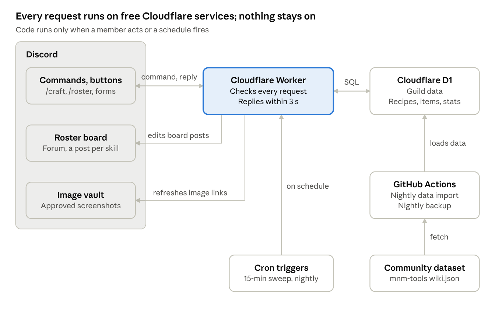

# Guild Crafting Bot — PRD & Database Schema

Oct 15, 2026 · @Joegandomi

## Overview

The guild will use a Discord bot, backed by a free hosted database, as its shared record of who can craft what. Members record skills, find crafters and browse the roster without leaving Discord. The target running cost is \$0 per month.

**Why the guild needs this.** Monsters & Memories is designed around crafters depending on each other, and a new guild has no shared record of who can make what.

- **Many skills, spread thin.** The game has about 35 tradeskills ([MNM Realm](https://mnmrealm.com/tradeskills)), and any character can train several. Each member ends up holding a small, different slice of the guild's crafting ability.

- **Recipes chain across skills.** Pelts go through Tanning before Leatherworking, and experimental magic gear requires a common crafted piece first ([tradeskills overview](https://thegameswiki.com/monsters-and-memories/wiki/tradeskills)). One finished item can need two or three crafters.

- **Skill level isn't the whole story.** Some recipes are bought from vendors, some are locked behind faction reputation, and some must be discovered (same source). Knowing who has a recipe matters as much as knowing who has the skill.

- **No marketplace search.** As of September 2026 there is no auction house or cross-zone search; the /auction channel reaches only the current zone (same source). Finding a crafter means asking the right people at the right time.

- **Chat doesn't scale.** Without a shared record, the default is asking in guild chat and waiting. Answers depend on who is online, scroll away within hours, and are never reliable enough to plan gear around.

The tool turns that scattered knowledge into one searchable, always-current answer to "who in the guild can make this?"

**Goals**

- Members record and update their own tradeskill levels per character in under 30 seconds, inside Discord.

- Anyone can type an item name and see the recipe, its trivial level and which guild members can make it.

- A read-only roster board in Discord stays current automatically, with one post per tradeskill.

- Item lookups show stat-sheet images or links where available.

- Recipe data refreshes from community sources without manual effort.

**Non-goals (v1)**

- A separate public website or in-Discord Activity (web app).

- Crafting-order workflow, payments, or material tracking.

- Support for multiple guilds (designed for, not built).

- Reading game files or logs.

**Success measures**

- At least 80% of active members have entered skills within 30 days of launch.

- Members run at least 20 item lookups a week by day 60 (the bot counts lookups in its audit log).

- Free-tier usage stays under 10% of every limit.

- Recipe data is no more than 7 days behind the community source.

## Users and use cases

Three roles cover everyone. Roles map to Discord server roles, so the guild manages access the way it already does.

| Role    | Discord mapping                 | Can do                                                                                                                                 |
|---------|---------------------------------|----------------------------------------------------------------------------------------------------------------------------------------|
| Member  | Guild member role               | Register characters, set own skill levels, mark known recipes, search and browse                                                       |
| Officer | Officer role                    | Everything a member can, plus edit or remove any member's entries, approve reports and guild recipes, and set how recipes are obtained |
| Admin   | Server admin or configured role | Configure channels and roles, trigger data refresh, rebuild the roster board                                                           |

**Core stories**

1.  As a member, I add my character and set Blacksmithing to 87 with one command.

2.  As a member, I type "Bronze Ch…", pick the item from autocomplete, and see the recipe, its components, a stat image, and who can make it.

3.  As a member, I open the roster forum, tap the Tailoring post, and see every tailor ranked by level.

4.  As a member, I run a roster command for one person and see all their skills and characters.

5.  As an officer, I remove a member who left the guild, and the board updates on its own.

6.  As a member, I flag a recipe that is wrong or missing so an officer can fix it.

## Functional requirements

The bot exposes eight member commands (`/me`, `/skills`, `/item`, `/gear`, `/roster`, `/zone`, `/request`, `/help`), `/officer` for officers and `/guildcraft` for admins, and maintains one auto-updating forum board. Every command is a slash command with autocomplete, so nobody has to remember exact item or skill names.

**Work order 18 (2026-10-21, CHECKLIST A20) renamed and merged the commands.** The tables below use the new names. Old → new:

| Old command | New |
|---|---|
| /character add, edit, remove → | `/me`: Add character, Edit character, Remove character |
| /craft set, /craft update → | `/skills` (with skill and level, or neither) |
| /craft me, /craft notify, /craft forget, a member's /craft requests → | `/me`: the panel, Notices, Forget a recipe, Cancel a request |
| /craft find, /craft know, /craft report, /item image → | `/item` (I know this recipe, Report a problem and Stat image are its buttons; `screenshot:` sends an image) |
| /gear find → | `/gear` |
| /craft request → | `/request` |
| /craft help → | `/help` |
| /recipe source, /recipe override → | `/officer recipe-source`, `/officer recipe-fix` |
| /guildcraft remove-member, an officer's /craft requests, member: on edits → | `/officer remove-member`, `/officer requests`, `/officer edit-member` |

### FR-1 Characters

| Command | Behavior |
|---|---|
| `/me` \[character\] | A private panel: the caller's characters (main marked), skills with stale markers, known recipes, request notices and open requests. Its buttons: **Add character** (name, class, level, main: a form), **Edit character** (rename, or change class, level or main), **Remove character** (soft-deletes the character and keeps its skills; the board drops it on the next refresh), **Update skills**, **Notices**, **Forget a recipe**, **Cancel a request**. A member may hold several characters. |
| `/officer edit-member` member: | Opens that member's `/me` panel for an officer; changes are recorded as the officer's. |

- The first character a member adds becomes their main. Commands that take an optional character: default to the main.

- Character names are unique per guild, case-insensitive.

### FR-2 Skills and known recipes

| Command | Behavior |
|---|---|
| `/skills` skill: level: \[character\] | Sets one tradeskill level. skill uses autocomplete, because Discord caps fixed choices at 25 and the game has about 35 tradeskills. |
| `/skills` \[character\] | With no skill and level: a tradeskill multi-select; after the member picks up to 5, a form with one level box per chosen skill. (A Discord form holds 5 inputs, so a dropdown plus a box per row would fit only 2 skills.) |
| **I know this recipe** (on `/item`) | Marks a recipe as known. Required for reputation and discovery recipes to count toward "can make" (FR-3.1); optional for vendor recipes. **Forget a recipe** on `/me` reverses it. |

- Levels are whole numbers from 0 to a configurable cap (default 300, adjustable once the game's cap is confirmed).

- Every change records who made it and when (updated_at, updated_by).

- A skill not updated in 60 days shows as "stale" on the board.

### FR-3 Find a crafter

`/item` name: returns one reply for any item (work order 18: items with no recipe too, with the recipes that use it as an ingredient):

1.  **Header:** item name, icon thumbnail, slot, and key stats (see FR-6).

2.  **Recipe:** tradeskill, trivial level, components with quantities, crafting station if known. Items with more than one recipe show each.

3.  **Crafters,** split into:

    - *Reliable:* skill ≥ trivial, sorted by level.

    - *Still learning:* within 25 points below trivial (adjustable), sorted by level. Anyone further below appears only as a count, so a level-5 skill doesn't clutter a level-200 recipe.

    - *Knows recipe:* flagged via **I know this recipe**, shown with a marker.

    - If the trivial level is unknown, all members with the tradeskill are listed by level, labeled "trivial unknown."

4.  **Buttons:** I know this recipe, Report a problem, Request a craft, Stat image, Post to channel, plus link buttons to the wiki, MnMdb and MNM Realm pages. A name the data lacks gets "No item called X" with Report a missing recipe.

**About trivial levels.** A recipe's trivial is the skill level at which it stops giving skill-ups; the community data records it for 328 of 615 recipes. The data does not record the level at which a recipe is first learned, so tiers are a guide, not a guarantee.

The reply is private by default. "Post to channel" re-posts it publicly so a member can ask for help.

### FR-3.1 Recipes gated by vendor, reputation or discovery

Skill level alone doesn't grant every recipe, so each recipe records how it is obtained, and `/item` only counts a character as able to make a gated recipe if they have marked it known. In Monsters & Memories most recipes are bought from vendors at a price tied to the skill they need, some are sold only to characters with enough faction standing, and experimental recipes are never sold and must be discovered ([tradeskills overview](https://thegameswiki.com/monsters-and-memories/wiki/tradeskills)).

| How obtained | What it means in game                                                                           | How the bot decides who can make it                                                                                                       |
|--------------|-------------------------------------------------------------------------------------------------|-------------------------------------------------------------------------------------------------------------------------------------------|
| Vendor       | Bought from a merchant or trainer; cost scales with the skill it needs                          | Skill tiers from FR-3 apply. The reply notes the recipe may need buying first, and where, if known.                                       |
| Reputation   | Sold only to characters with enough faction standing (for example the Red Mantle Quartermaster) | Only characters who marked it known count as able. Others with the skill appear as "has skill, needs reputation," with the faction named. |
| Discovery    | Experimental recipes found by testing combinations; not sold anywhere                           | Only characters who marked it known count as able. The recipe may not exist in community data at all.                                     |
| Unknown      | Not recorded yet                                                                                | Skill tiers from FR-3 apply, with a note to confirm the crafter has the recipe.                                                           |

- **Starting point.** The community data doesn't record how recipes are obtained, so every imported recipe starts as Unknown. Officers set the real value with `/officer recipe-source` item: how: \[faction\] \[note\], and member reports feed the same queue. These corrections survive the nightly import, like overrides.

- **One-click marking.** Every `/item` reply for a craftable item has an "I know this recipe" button, so marking a gated recipe takes one click from the place a member sees it.

- **Discovered recipes.** `/recipe add` (not built yet: after launch) lets a member record a recipe the community data lacks: tradeskill, result item, components and trivial if known. An officer approves it before it appears. It is **guild-private by default**, visible only to this guild and never shared upstream, so the guild keeps its discoveries. An officer can make it public later.

- **Who knows the rare ones.** `/roster recipes` \[skill\] lists every reputation and discovery recipe that at least one guild character has marked known, and who knows it.

- **Out of scope.** The bot doesn't track each character's faction standing. For reputation recipes it names the faction so members know what to work toward.

### FR-4 Roster commands

| Command | Behavior |
|---|---|
| `/roster skill` skill: \[min_level\] | Ranked list of every character with that tradeskill, 15 per page, with Previous/Next buttons and a dropdown to switch tradeskill. |
| `/roster member` member: @user | All of one member's characters and skills, grouped by character. |
| `/roster top` | The top 3 characters in each tradeskill, one compact list. (The rare-recipe roster, `/roster recipes`, is in FR-3.1.) |
| `/gear` class: … | Gear for a class, by slot, weapon type, AC, ratio, stats, source and zone (work order 13). |
| `/zone` name: | A zone's card: level range, creatures, and links to the wikis and MnM Atlas (work order 17). |
| `/request` item: \[quantity\] \[note\] | Asks the opted-in crafters who can make an item, in a private thread (work order 16). |
| `/help` | A guide in pages, one button per page. |

Discord dropdowns hold at most 25 options, so the tradeskill switcher lists only skills with at least one member, split alphabetically across two dropdowns (A–M, N–Z) when more than 25 are in use.

### FR-5 Roster board (forum channel)

- An admin runs `/guildcraft setup` board:#forum-channel once. The bot creates one forum post per tradeskill, titled with the skill name only. The member count lives in the post body, because Discord tightly rate-limits renaming channels and threads.

- Each post's first message is a ranked list (rank, character, member, level, stale marker), owned and edited only by the bot. Members can reply in the post, for example to request crafts.

- When a skill changes, the bot marks that tradeskill "dirty" and rewrites its post within about 1 minute. A scheduled sweep every 15 minutes catches anything missed, and a nightly job rebuilds every post.

- A Discord message holds about 6,000 characters of embed text, roughly 150 roster lines. Larger lists continue in bot-owned follow-up messages in the same post.

- A pinned "Index" post links to every tradeskill post and shows last-refresh time. While a board fills it also shows one line with how many of its posts exist and about how long the rest will take (order 30).

- A forum GuildCraft creates gets short post guidelines saying what it holds and that GuildCraft writes its posts. GuildCraft never touches them after that, so officers can change them (order 30).

### FR-6 Item stats and images

- Item stats come from the community dataset (slot, AC, damage/delay, stats, resists, weight, classes, races) and render as embed fields with the item icon as thumbnail.

- Members can submit a screenshot of the in-game item window with `/item` name: screenshot:. Officers approve it with one button before it shows publicly.

- Every item reply links to its wiki, MnMdb and MNM Realm pages. The Item stats and images section covers sources and storage.

### FR-7 Data quality

- **Report a problem** on an `/item` card files a report (wrong trivial, wrong components, wrong source, missing recipe, other; or, for item data, wrong stats, source or class) into an officer review queue channel with Mark fixed/Dismiss buttons. A name the data lacks can be reported as a missing recipe. The officer fixes the data with `/officer recipe-fix` or `/officer recipe-source`; the buttons only record the outcome. (Amended by work order 9, override 4: "wrong source" and "other" added; the buttons were "Approve/Dismiss".)

- Officers can override an existing recipe's trivial or components with `/officer recipe-fix`, for their own server only. Overrides survive the nightly re-import. (Work order 9: adding a recipe, `/recipe add`, moves to after launch.)

### FR-8 Administration

| Command | Who | Behavior |
|---|---|---|
| `/guildcraft setup` | Admin | Sets board channel, review, vault and request channels, member role and officer role. |
| `/guildcraft rebuild-board` | Admin | Forces a full board rebuild. |
| `/guildcraft status` | Admin | Shows data version, last import, last board refresh and free-tier usage. |
| `/officer remove-member` member: | Officer | Removes a departed member's characters and skills. |
| `/officer edit-member` member: | Officer | Opens that member's `/me` panel (FR-1). |
| `/officer recipe-source`, `/officer recipe-fix` | Officer | How a recipe is obtained; its trivial or ingredients (FR-3.1, FR-7). |
| `/officer requests` | Officer | Every open craft request, paged, with Cancel. |

`/officer` and `/guildcraft` are shown to Manage Server by default; a server admin grants `/officer` to the officer role once (Server Settings → Integrations → the app → `/officer`).

A member's record is created or refreshed the first time they use the bot. The nightly job compares that list with the server's current members (this needs the Server Members intent) and flags anyone who left for officer review. Data is never deleted automatically.

Officer and admin commands are hidden from regular members using Discord's default command permissions, and the Worker re-checks the caller's roles on every request, so hiding a command is never the only safeguard.

### FR-9 Onboarding

- The first time a member uses any command, the bot replies privately with a three-step welcome: add a character, set skills, try a lookup.

- `/help` shows a guide to every command, in pages with a button for each (work order 18; it was one screen).

- The board's index post explains how to get listed, so new recruits can join the roster on their own.

## Recommended tech stack

The whole system runs on free tiers at \$0 per month with no credit card: Discord's HTTP interactions, one Cloudflare Worker, a Cloudflare D1 database, and a GitHub Actions job for data imports. Nothing runs around the clock, so there is no server to host or pay for.

| Layer              | Choice                                                                                                         | Why                                                                                                                                                     | Free-tier limit                                                                  | Expected use (50-member guild) |
|--------------------|----------------------------------------------------------------------------------------------------------------|---------------------------------------------------------------------------------------------------------------------------------------------------------|----------------------------------------------------------------------------------|--------------------------------|
| Chat interface     | Discord app with slash commands, buttons, forms                                                                | Members never leave Discord; Discord handles login and roles                                                                                            | Free                                                                             | n/a                            |
| Request handling   | [Cloudflare Workers](https://developers.cloudflare.com/workers/platform/limits/) (TypeScript)                  | Discord can call it directly over HTTPS; official Discord tutorial exists                                                                               | 100,000 requests/day, 10 ms CPU/request, 50 subrequests/request, 5 cron triggers | ~1,000 requests/day            |
| Database           | [Cloudflare D1](https://freetier.co/articles/cloudflare-d1-free-tier-limits-pricing-and-alternatives) (SQLite) | Same account as the Worker; plain SQL; no pausing when idle                                                                                             | 5 GB storage, ~5M row reads/day, ~100K row writes/day                            | \< 20 MB, \< 100K reads/day    |
| Scheduled jobs     | Workers cron triggers                                                                                          | Board sweep every 15 min, nightly rebuild                                                                                                               | 5 per account                                                                    | 2 used                         |
| Data import        | GitHub Actions in a public repo                                                                                | Parses the 3 MB community dataset outside the Worker's 10 ms CPU budget, then writes only changed rows to D1 using an API token kept as a GitHub secret | Free for public repos                                                            | 1 run/night, ~2 min            |
| Item image storage | Private Discord "vault" channel                                                                                | Stores approved screenshots at no cost and no card                                                                                                      | Free                                                                             | \< 1,000 images                |
| Source control     | GitHub (public repo)                                                                                           | Free Actions minutes; guild members can contribute                                                                                                      | Free                                                                             | n/a                            |
| Libraries          | discord-interactions (request signing), Hono or itty-router (routing), Drizzle or raw SQL                      | Small, Workers-compatible                                                                                                                               | Free                                                                             | n/a                            |

**Why not the alternatives**

- **Always-connected bot (discord.js on a VPS):** needs a server running 24/7, and free hosting for those has largely disappeared. HTTP interactions do everything this PRD needs.

- **Supabase:** a good database, but free projects pause after 7 days of low activity, which would break the bot during quiet weeks ([Supabase docs](https://supabase.com/docs/guides/platform/free-project-pausing)).

- **Cloudflare R2 for images:** 10 GB free with free egress ([R2 pricing](https://developers.cloudflare.com/r2/pricing/)), but activating R2 requires adding a credit card or PayPal ([setup guide](https://eastondev.com/blog/en/posts/dev/20251130-r2-picgo-setup/)). It is the upgrade path if the vault channel proves awkward.

- **Airtable / Google Sheets as the database:** record caps and API rate limits, and a shared spreadsheet is hard to read, search and keep current as a guild grows.

**Cost ceiling.** If the guild ever outgrew the free tier, Workers Paid is \$5 per month and covers D1 well past any guild's needs. At current estimates usage stays under 2% of free limits.

## Architecture and data flows

One Cloudflare Worker sits between Discord and the database and runs only when called. Discord calls it when a member uses a command; cron triggers call it on a schedule; a separate GitHub Actions job loads recipe data.

System architecture · Discord, one Worker, D1, scheduled jobs

**Command flow.** Discord sends each command to the Worker, which verifies Discord's signature, queries D1 and replies within 3 seconds. After a skill change it replies first, then marks that tradeskill's board post dirty and rewrites it in the background.

**Board flow.** Cron runs every 15 minutes to rewrite any dirty posts, and nightly to rebuild all of them. Posts whose content hash is unchanged are skipped, which keeps Discord API calls low.

**Data flow.** Each night GitHub Actions downloads the community dataset, checks its structure, converts it to SQL upserts and loads D1. Parsing happens there because the 3 MB file would exceed the Worker's 10 ms CPU budget. The same job exports a database backup.

## Database schema

The schema has 14 tables in two groups. Game reference data (tradeskills, items, recipes) is shared and replaced by the nightly import. Guild data (members, characters, skills, board state) is keyed by Discord server ID, so a second guild could use the same bot later without changes.

| Table            | Group     | Holds                                                                                         | Written by        |
|------------------|-----------|-----------------------------------------------------------------------------------------------|-------------------|
| tradeskill       | Reference | The ~35 tradeskills, crafting or gathering                                                    | Import            |
| item             | Reference | Item name, icon, stats, external links                                                        | Import            |
| recipe           | Reference | Result item, tradeskill, trivial, how it's obtained, source (wiki, override or guild-private) | Import, officers  |
| recipe_component | Reference | Ingredients and quantities per recipe                                                         | Import, officers  |
| guild            | Guild     | Server settings: channels, roles, skill cap                                                   | Admin             |
| member           | Guild     | Discord users in the guild, active or left                                                    | Bot               |
| character        | Guild     | Characters per member, main flag                                                              | Members           |
| character_skill  | Guild     | Level per character per tradeskill                                                            | Members           |
| character_recipe | Guild     | Recipes a character has marked as known                                                       | Members           |
| item_image       | Guild     | Submitted stat screenshots and approval state                                                 | Members, officers |
| recipe_report    | Guild     | Data-quality reports and their resolution                                                     | Members, officers |
| board_post       | Guild     | Forum post and message IDs per tradeskill, dirty flag                                         | Bot               |
| data_import      | System    | Each import run: source version, counts, status                                               | Import            |
| audit_log        | System    | Who changed what, when                                                                        | Bot               |

-- ============ Reference data (shared, refreshed nightly) ============  
CREATE TABLE tradeskill (  
id INTEGER PRIMARY KEY,  
name TEXT NOT NULL UNIQUE, -- 'Blacksmithing'  
kind TEXT NOT NULL CHECK (kind IN ('crafting','gathering')),  
sort_order INTEGER NOT NULL DEFAULT 0  
);  
  
CREATE TABLE item (  
id INTEGER PRIMARY KEY,  
name TEXT NOT NULL,  
name_key TEXT NOT NULL UNIQUE, -- lower(name), for autocomplete  
icon_url TEXT, -- wiki icon, 64 px  
slot TEXT,  
stats_json TEXT, -- {ac, dmg, delay, hp, mana, stats{}, resists{}, weight, size, class, race, flags\[\]}  
wiki_url TEXT,  
mnmdb_url TEXT,  
mnmrealm_url TEXT,  
source TEXT NOT NULL DEFAULT 'wiki',  
imported_at TEXT NOT NULL  
);  
  
CREATE TABLE recipe (  
id INTEGER PRIMARY KEY,  
source_key TEXT NOT NULL UNIQUE, -- tradeskill + result item (+ variant \#); stable when components change  
tradeskill_id INTEGER NOT NULL REFERENCES tradeskill(id),  
result_item_id INTEGER NOT NULL REFERENCES item(id),  
result_qty INTEGER NOT NULL DEFAULT 1,  
trivial INTEGER, -- NULL = unknown  
station TEXT,  
acquisition TEXT NOT NULL DEFAULT 'unknown'  
CHECK (acquisition IN ('vendor','reputation','discovery','unknown')),  
faction TEXT, -- reputation recipes: faction that sells it  
acquisition_note TEXT, -- vendor name, standing needed, discovery hint  
source TEXT NOT NULL CHECK (source IN ('wiki','override','guild')),  
guild_id TEXT, -- set = guild-private recipe added by members  
active INTEGER NOT NULL DEFAULT 1, -- 0 = superseded, removed upstream, or awaiting approval  
imported_at TEXT NOT NULL  
);  
CREATE INDEX recipe_by_result ON recipe(result_item_id) WHERE active = 1;  
  
CREATE TABLE recipe_component (  
recipe_id INTEGER NOT NULL REFERENCES recipe(id) ON DELETE CASCADE,  
item_id INTEGER NOT NULL REFERENCES item(id),  
qty INTEGER NOT NULL,  
PRIMARY KEY (recipe_id, item_id)  
);  
  
-- ============ Guild data (keyed by Discord server) ============  
CREATE TABLE guild (  
id TEXT PRIMARY KEY, -- Discord guild (server) ID  
name TEXT NOT NULL,  
board_channel_id TEXT, -- forum channel  
review_channel_id TEXT,  
vault_channel_id TEXT, -- private channel holding approved images  
member_role_id TEXT,  
officer_role_id TEXT,  
skill_cap INTEGER NOT NULL DEFAULT 300,  
stale_days INTEGER NOT NULL DEFAULT 60,  
created_at TEXT NOT NULL  
);  
  
CREATE TABLE member (  
guild_id TEXT NOT NULL REFERENCES guild(id),  
discord_user_id TEXT NOT NULL,  
display_name TEXT NOT NULL,  
status TEXT NOT NULL DEFAULT 'active' CHECK (status IN ('active','left')),  
first_seen_at TEXT NOT NULL,  
PRIMARY KEY (guild_id, discord_user_id)  
);  
  
CREATE TABLE character (  
id INTEGER PRIMARY KEY,  
guild_id TEXT NOT NULL,  
owner_user_id TEXT NOT NULL,  
name TEXT NOT NULL,  
name_key TEXT NOT NULL, -- lower(name)  
class TEXT,  
level INTEGER,  
is_main INTEGER NOT NULL DEFAULT 0,  
deleted_at TEXT,  
created_at TEXT NOT NULL,  
updated_at TEXT NOT NULL,  
FOREIGN KEY (guild_id, owner_user_id) REFERENCES member(guild_id, discord_user_id),  
UNIQUE (guild_id, name_key)  
);  
CREATE INDEX character_by_owner ON character(guild_id, owner_user_id);  
  
CREATE TABLE character_skill (  
character_id INTEGER NOT NULL REFERENCES character(id) ON DELETE CASCADE,  
tradeskill_id INTEGER NOT NULL REFERENCES tradeskill(id),  
level INTEGER NOT NULL CHECK (level \>= 0),  
updated_at TEXT NOT NULL,  
updated_by TEXT NOT NULL, -- Discord user ID (owner or officer)  
PRIMARY KEY (character_id, tradeskill_id)  
);  
CREATE INDEX skill_ranking ON character_skill(tradeskill_id, level DESC);  
  
CREATE TABLE character_recipe (  
character_id INTEGER NOT NULL REFERENCES character(id) ON DELETE CASCADE,  
recipe_id INTEGER NOT NULL REFERENCES recipe(id),  
created_at TEXT NOT NULL,  
PRIMARY KEY (character_id, recipe_id)  
);  
  
CREATE TABLE item_image (  
id INTEGER PRIMARY KEY,  
guild_id TEXT NOT NULL,  
item_id INTEGER NOT NULL REFERENCES item(id),  
vault_message_id TEXT, -- message in the vault channel  
attachment_id TEXT, -- used to refresh the expiring CDN URL  
cached_url TEXT,  
cached_url_expires_at TEXT,  
submitted_by TEXT NOT NULL,  
status TEXT NOT NULL DEFAULT 'pending' CHECK (status IN ('pending','approved','rejected')),  
reviewed_by TEXT,  
created_at TEXT NOT NULL  
);  
CREATE INDEX image_by_item ON item_image(guild_id, item_id, status);  
  
CREATE TABLE recipe_report (  
id INTEGER PRIMARY KEY,  
guild_id TEXT NOT NULL,  
item_id INTEGER REFERENCES item(id),  
recipe_id INTEGER REFERENCES recipe(id),  
reporter TEXT NOT NULL,  
issue TEXT NOT NULL,  
status TEXT NOT NULL DEFAULT 'open' CHECK (status IN ('open','fixed','dismissed')),  
resolved_by TEXT,  
created_at TEXT NOT NULL,  
resolved_at TEXT  
);  
  
CREATE TABLE board_post (  
guild_id TEXT NOT NULL,  
tradeskill_id INTEGER NOT NULL REFERENCES tradeskill(id),  
thread_id TEXT NOT NULL, -- forum post  
message_ids_json TEXT NOT NULL, -- ordered bot-owned messages: \[first, ...overflow\]  
content_hash TEXT, -- skip edits when nothing changed  
dirty INTEGER NOT NULL DEFAULT 1,  
last_rendered_at TEXT,  
PRIMARY KEY (guild_id, tradeskill_id)  
);  
  
-- ============ System ============  
CREATE TABLE data_import (  
id INTEGER PRIMARY KEY,  
source TEXT NOT NULL, -- 'mnm-tools/wiki.json'  
source_version TEXT NOT NULL, -- dataset generatedAt or commit SHA  
items INTEGER, recipes INTEGER,  
status TEXT NOT NULL, -- 'ok' \| 'failed'  
error TEXT,  
started_at TEXT NOT NULL,  
finished_at TEXT  
);  
  
CREATE TABLE audit_log (  
id INTEGER PRIMARY KEY,  
guild_id TEXT NOT NULL,  
actor TEXT NOT NULL,  
action TEXT NOT NULL, -- 'skill.set', 'character.remove', 'craft.find', ...  
target TEXT,  
detail_json TEXT,  
created_at TEXT NOT NULL  
);

**The core query.** `/item` (formerly /craft find) answers "who can make this?" in one indexed query:

SELECT r.id AS recipe_id, r.acquisition, r.faction, c.name AS character, m.display_name AS member, cs.level, r.trivial,  
CASE WHEN r.acquisition IN ('reputation','discovery')  
AND NOT EXISTS (SELECT 1 FROM character_recipe k  
WHERE k.character_id = c.id AND k.recipe_id = r.id)  
THEN 'recipe not confirmed'  
WHEN r.trivial IS NULL THEN 'trivial unknown'  
WHEN cs.level \>= r.trivial THEN 'reliable'  
ELSE 'still learning' END AS tier,  
EXISTS (SELECT 1 FROM character_recipe cr  
WHERE cr.character_id = c.id AND cr.recipe_id = r.id) AS knows_recipe  
FROM recipe r  
JOIN character_skill cs ON cs.tradeskill_id = r.tradeskill_id  
JOIN character c ON c.id = cs.character_id AND c.deleted_at IS NULL  
JOIN member m ON m.guild_id = c.guild_id AND m.discord_user_id = c.owner_user_id  
WHERE r.result_item_id = ?1 AND r.active = 1  
AND (r.guild_id IS NULL OR r.guild_id = ?2) -- shared + this guild's private recipes  
AND c.guild_id = ?2 AND m.status = 'active'  
ORDER BY CASE tier WHEN 'reliable' THEN 1 WHEN 'still learning' THEN 2  
WHEN 'trivial unknown' THEN 3 ELSE 4 END,  
knows_recipe DESC, cs.level DESC;  
-- The 25-point "still learning" window and the count of lower-skill members are applied in code.

**Design notes**

- Item autocomplete is a prefix range scan on item.name_key (about 5,350 items), well under the 3-second reply limit.

- Officer corrections are a guild-scoped layer (work order 9, override 2; migration 0009): recipe_correction, keyed (guild_id, recipe_id), holds a guild's acquisition, faction, note and trivial, and recipe_correction_component its corrected component list, which replaces the whole imported list for that guild. Readers use the guild's value where one is set and the imported value otherwise; the import never touches the layer. One deployment serves many guilds, so corrections are never written to the shared recipe row. This replaces the earlier design (override rows with source = 'override', the wiki recipe set to active = 0); source = 'override' is unused, and recipe.acquisition stays at its default, unknown.

- Discord IDs are stored as TEXT because they exceed JavaScript's safe integer range.

- Timestamps are ISO-8601 UTC strings, SQLite's convention.

Recipes missing from the latest import are set to active = 0, never deleted, so members' known-recipe marks survive upstream changes. An item with several recipes returns one group of rows per recipe_id.

## Item stats and images

Item stats can be shown for most craftable items at no cost, using three layers: structured stats rendered as Discord fields, the wiki icon as a thumbnail, and optional member-submitted screenshots. Links to three fan databases cover anything the bot doesn't show.

**Coverage today.** In the community dataset (5,349 items, refreshed 2026-10-14), the 595 distinct craftable results break down as follows:

| Data available             | Craftable items | Share |
|----------------------------|-----------------|-------|
| Matching item record       | 467             | 78%   |
| Icon image                 | 417             | 70%   |
| Stats, AC or damage values | 300             | 50%   |

Many items without stats are components (bars, thread, leather), which have no combat stats anyway.

### Layer 1: stats as embed fields (default)

- The import stores each item's slot, AC, damage/delay, HP/mana, attribute stats, resists, weight, size, classes, races and flags in item.stats_json.

- The bot renders them as compact embed fields (for example AC 2 · FACE · 0.4 wt · ALL/ALL). This is searchable, copyable text and works on phones.

- The item icon (64 px, hosted by the wiki) is the embed thumbnail. The footer credits the source: "Item data: Monsters and Memories Wiki, CC BY-SA 4.0."

### Layer 2: member screenshots of the in-game item window

- `/item` name: screenshot: accepts an image attachment. The bot re-posts it to a private vault channel and files it as pending; officers approve or reject with a button.

- Discord attachment links now expire. Each link carries an expiry timestamp and stops working after it passes. The bot gets a fresh one by reading the vault message again (Get Channel Message): Discord's reference says "when your app receives a payload with a signed URL (like when you fetch a message), it will be valid" ([Signed Attachment CDN URLs](https://docs.discord.com/developers/reference)). (Amended by work order 9, override 5: the refresh-urls endpoint named here before is not in Discord's reference and is not used.)

- The bot therefore stores the vault message and attachment IDs, caches the current link with its expiry, and refreshes it on demand. Storage stays free and needs no credit card.

- The "Stat image" button on `/item` shows the approved screenshot, or says none exists yet and invites a submission.

- Upgrade path: copy approved images to Cloudflare R2 for permanent links, if the guild accepts adding a payment method.

### Layer 3: external links

Every item reply carries link buttons to the item's page on each site. URL patterns are computed during import and verified by a link check in the import job.

| Site                                                                    | What it adds                               | Link pattern                 |
|-------------------------------------------------------------------------|--------------------------------------------|------------------------------|
| [Monsters and Memories Wiki](https://monstersandmemories.miraheze.org/) | Full item page, drop sources, player notes | /wiki/\<Item_Name\>          |
| [MnMdb](https://mnm-db.com/)                                            | Drop rates, vendor and auction prices      | /#/item/\<id\>               |
| [MNM Realm](https://mnmrealm.com/)                                      | Related recipes, NPCs, quests              | /items/\<slug\> (to confirm) |

**Not in v1.** A generated stat-card image (an in-game-style tooltip drawn as a PNG) is possible later. It would be rendered by the import job rather than the Worker, to stay inside the 10 ms CPU limit.

## Constraints, risks and delivery plan

The design fits inside Discord's interaction limits and Cloudflare's free tier with wide margins. The main risk is recipe data quality, not cost or scale.

### Non-functional requirements

- **Speed:** commands reply in under 1 second at the 95th percentile; anything slower shows Discord's "thinking…" state first.

- **Cost:** \$0 per month; /guildcraft status reports usage against each free limit.

- **Privacy:** stores only Discord user IDs, display names, character names and skill data. No game account data and no message content.

- **Backup:** the nightly job exports the database to a separate private GitHub repository (the code repository stays public), so a lost account loses at most one day of changes.

- **Bus factor:** at least two guild members have admin access to the Discord app, the Cloudflare account and the GitHub repo.

- **Attribution:** replies credit the wiki (CC BY-SA 4.0); the README credits mnm-tools (MIT).

### Discord limits the design respects

| Limit                  | Value                       | How the design handles it                                   |
|------------------------|-----------------------------|-------------------------------------------------------------|
| First reply deadline   | 3 seconds                   | Defer, then edit; the find query is a single indexed lookup |
| Follow-up window       | 15 minutes per interaction  | Page buttons start a new interaction each click             |
| Autocomplete choices   | 25                          | Prefix search returns the top 25 matches                    |
| Dropdown options       | 25                          | Tradeskill switcher split A–M and N–Z                       |
| Embed text per message | 6,000 characters, 10 embeds | Board overflows into extra bot-owned messages               |
| Plain message text     | 2,000 characters            | All formatted output uses embeds                            |

Sources: [interactions](https://docs.discord.com/developers/interactions/receiving-and-responding), [message and embed limits](https://docs.discord.com/developers/resources/message), [components](https://docs.discord.com/developers/components/reference).

**Bot permissions:** View Channel, Send Messages, Send Messages in Threads, Create Public Threads, Manage Threads (board channel only), Embed Links, Attach Files, Read Message History. Detecting members who left the server needs the Server Members intent switched on in the developer portal.

### Risks

| Risk                                               | Impact                                          | Mitigation                                                                                                                               |
|----------------------------------------------------|-------------------------------------------------|------------------------------------------------------------------------------------------------------------------------------------------|
| Only 328 of 615 recipes have a known trivial level | "Who can make it" is fuzzy for half the recipes | "Trivial unknown" tier, member reports, officer overrides                                                                                |
| Recipes change with Early Access patches           | Stale results                                   | Nightly import; data version shown in replies                                                                                            |
| Community dataset changes format or disappears     | Import breaks                                   | Schema check before load; keep last good data; post failures to the review channel; fallback importer that reads the wiki's API directly |
| A Discord or Cloudflare limit changes              | Feature or cost change                          | Usage shown in /guildcraft status; \$5/month fallback                                                                                    |
| One person maintains it                            | Bot dies when they leave                        | Public repo, setup guide, two admins                                                                                                     |
| Members don't keep levels current                  | Board goes stale                                | Stale markers; officer prompt for skills older than 60 days                                                                              |

### Open questions

- [ ] How many members and characters does the guild have? This decides board pagination.

- [ ] What is the game's tradeskill cap, and should gathering skills appear on the board?

- [ ] Who owns the Discord app, Cloudflare account and GitHub repo?

- [ ] Should screenshots and member-added recipes need officer approval, and should added recipes stay guild-private by default (proposed: yes to both)?

- [ ] Should /craft find reply privately or publicly by default?

- [ ] Ask the mnm-tools maintainer for permission to consume their dataset, as a courtesy.

### Delivery plan

1.  **Foundation:** a test Discord server and separate dev database, then the Discord app, Worker, D1 schema and nightly import job; /character and /craft set, /craft update, /craft me.

2.  **Search:** /craft find with stats, icon, links and crafter tiers; /roster skill, /roster member, /roster top.

3.  **Board:** forum posts per tradeskill, dirty-flag refresh, 15-minute sweep, nightly rebuild, index post.

4.  **Quality and images:** reports, overrides, known recipes, recipe sources (FR-3.1), guild-private recipes, screenshot vault with approval.

5.  **Launch:** announce the bot, pin the help guide, and run a sign-up push so the board fills in during the first week.

## DKP add-on (orders 27–28)

Approved by the owner on 2026-10-29. DKP is an optional add-on that a server's admin adds or removes with **Add DKP** and **Remove DKP** in `/guildcraft setup`. Points are paid for each named kill a member is present for (ticks). Points are kept per raid zone. The rules guard against leadership bias and against banking points before leaving.

**Principles.** The bot decides, and officers correct in public with a reason. Points are earned for being present when it matters. Points are spent only where they were earned (order 28). Every rule is a setting with a default.

**Pools.**

- Each raid zone, picked from GuildCraft's zone list, is its own raid pool.
- The guild pool is earned at a smaller rate, and order 28's shop spends it.
- Points belong to the member (the Discord user), not to a character. Everyone starts at zero.

**Who earns: members and frozen members.**

- Tapping a raid button refreshes the member's row, as a slash command does. The member-role gate applies, and a member without that role is refused privately.
- A member whose status is 'left' is frozen. They earn nothing, and the standings show them as frozen.
- A frozen member thaws on their own next command or raid-button press.
- An officer's Remove freezes a member the same way, until they come back by themselves.
- "Leaving the server" means the nightly run's mark. A member who left today keeps the state they had until that run.

**Raid night.** One raid is open per server at a time.

- *Opening.* An officer runs `/dkp raid zone: mode:` (per named kill, or flat), and the bot posts a raid card in GC-DKP. If a raid is already open, the command is refused with a link to it.
- *Checking in.*
  - Members tap Present, or Standby if they are held outside a full raid.
  - Their state carries over to every later kill until they tap Leaving or an officer changes it.
  - Tapping Present after a kill does not earn that kill, only later ones.
- *Named killed.*
  - The button offers the zone's creatures in a select menu: the first 25 in display order. Order 28's override 4 (shipped in order 28b): raid encounters first, then named mobs, then "Other creatures", each part A→Z, from the wiki's own tags (Category:Raid Encounters, Category:Named Mobs; `npc.raid`, `npc.named`). Each option names its part under its label. Nothing is inferred from a name.
  - `/dkp kill named:` covers every creature, with autocomplete. It also accepts a typed name, stored as typed, for creatures the data doesn't list.
  - The creature list is the union of the zone's mobs and NPCs, deduplicated by case-insensitive name, without merchants.
  - A zone with no creatures shows no select menu; the card says to use `/dkp kill`.
  - The same named recorded twice within 2 minutes asks the officer to confirm it was a respawn. Otherwise each record is a kill.
- *Payout.*
  - Everyone Present at that moment earns the named's raid points and the guild points. Order 29: everyone Standby at that moment goes on the kill's roster and earns the standby value once, at close (below); a raid opened before order 29 keeps the old rule (Standby earned each kill).
  - The kill line on the card shows the named, the points, how many earned, and the changes against the previous kill (for example +Kestrel −Pip).
  - Who earned answers privately with the full list.
- *Check again* (officer, per kill).
  - For the window (default 300 seconds), members credited on that kill tap Present again to keep it.
  - Those who don't are removed from that kill when the window closes. They are then absent for later kills until they tap Present.
  - A member who first taps Present inside the window doesn't gain that kill; an officer correction can add them.
- *Corrections.*
  - An officer adds or removes a member on a kill, or on the whole raid. The reason is required and shown.
  - A correction whose total is over 20 points needs a second officer, as adjustments do.
- *Flat mode.* There is no Named killed. Pay attendance pays the flat value once, to everyone Present at that moment; Standby at that moment earns the standby value once, at close (order 29).
- *Closing.*
  - Close raid posts the night's summary and refreshes the standings.
  - A raid nobody closes closes itself after 8 hours.
  - If DKP is removed mid-raid, the raid closes at once, its timers are cancelled, and its buttons answer "DKP is off on this server".

**Card size.**

- The raid card shows names only up to a limit. Beyond it, the card shows counts, plus Who's here and Who earned buttons that answer privately.
- Standings are one message per pool, showing the top members, with Full standings answering privately and paged.

**Adjustments.**

- `/dkp adjust member: pool: points: reason:` takes a reason, which is required, and the change is posted publicly in GC-DKP.
- A change over 20 points (either sign) posts an approval card instead. Another officer presses Approve within 24 hours, or it lapses.
- Nobody changes, or approves a change to, their own points.

**Settings.**

- `/dkp settings` is admin only. Each change is posted publicly and applies from then on.
- `/dkp named-value zone: named: points:` is for officers. It is posted publicly and applies from then on.

| Setting | Default |
|---|---|
| Raid points per named kill | 10 |
| Flat raid value | 30 |
| Guild points per kill or flat payout | 2 |
| Pool cap | 200 (order 29; it was 100) |
| Standby value (order 29) | 30 |
| Wins per raid (order 29) | 2 |
| Wins per 7 days (order 29) | 4 |
| New-member wait (order 29) | 3 kills in that pool |
| Raid auction length (order 29) | 180 seconds |
| General auction length (order 29) | 24 hours |
| Decay after (order 29) | 180 idle days |
| Decay per week (order 29) | 10% |
| Wishlist size (order 29) | 30 items |
| Check-again window | 300 seconds |
| Second officer needed | over 20 points |
| Approval lapses after | 24 hours |
| Raid auto-closes after | 8 hours |
| Who runs DKP | the officer role (and admins) |

**Seeing points.** Points are public within the server.

- Standings messages sit at the top of GC-DKP, one per pool. They are edited after each raid closes and after each adjustment.
- 30-day attendance is the kills (and flat payouts) a member earned in a pool, divided by those the pool held, over the last 30 days.
- `/dkp history member: pool:` answers privately: ledger rows, newest first, paged.
- `/me` shows balances per pool and 30-day attendance, where DKP is on.

**Order 29: spending points** (approved by the owner on 2026-10-29, 16:08 and 16:12 ET). The bot decides every auction: bids stay hidden from everyone until close, closing is by timer only, and the price is computed. Every spend, refund, standby payout and decay is a ledger row; balances stay derived.

- *Standby* (raids opened from order 29 on). A member who is Standby at one or more kills (or at a flat raid's Pay attendance) earns the standby value once (its own setting, default 30), paid when the raid closes, with the guild points for that payout. The raid closes this way however it closes: an officer, auto-close, or Remove DKP. Mixed attendance: the per-kill points for the Present kills, plus the standby value once. Removing a member's last Standby kill before close means no standby pay; after close, a correction row reverses the standby row. The pool cap applies.
- *Cap.* The default is 200. A server's admin can set it to anything in `/dkp settings`; servers that never changed it get 200 at once.
- *Who was at a kill* is the kill's roster (who was Present or Standby), written with the kill and updated by Check again and corrections.
- *Raid auctions.*
  - Starting one: from the raid card, **Auction a drop** offers the latest kill's known loot (the named's loot names matched to items, at most 25), or `/dkp auction item:` picks any item. A raid auction needs an open raid; with none, the reply points to the general auction. The officer can set a minimum bid (default 1) and a duration (default 3 minutes). The card shows the item's stats (the `/item` card).
  - Who may bid: a member Present or Standby at one or more kills of that raid (points belong to the member, so the item can go to any of their characters), under the win limits (2 per raid, 4 in any 7 days; general-auction wins count only toward the 7 days; shop purchases toward neither), past the new-member wait (3 kills, Present or Standby, in that raid zone's pool, ever), and not frozen. One function decides this.
  - Bidding: **Bid** opens a form for an amount: a whole number, at least the minimum, at most the member's balance in that raid's pool. A bid counts only if it arrives before the close time by the server's clock. While the auction is open a member can raise, lower or withdraw their bid. Nobody sees any bid, officers included; the card shows only the number of bidders.
  - Closing: on the timer only, with no extension. Every bid is checked again against the bidder's balance; one that can no longer be paid is dropped, and the result says so. The price is the second-highest valid bid + 1, never more than the winner's own bid; a lone bidder pays the minimum. A tie goes to the higher 30-day attendance in that pool, then to the earlier bid. The winner's points come off as a spend row. The result is posted with every bid revealed (members shown, nobody pinged) and the price.
  - Cancel: an officer can cancel an open auction unless they have bid in it. The reason is required; the cancellation is public and reveals the bids. There's no spend.
  - An auction open when its raid closes runs to its timer. Remove DKP cancels every open auction ("DKP removed", bids revealed) before the timers are cleared. An auction with no bids offers **Post to general auction**.
- *The general auction.* An officer posts any item, or one that went unsold, for guild points. Every active member may bid: no presence rule and no new-member wait, but the win limits count. The same sealed bids, price rule and timer, 24 hours by default. If it expires unsold, the officer records what was done with the item (free text, public), and the record is kept.
- *The item queue.* From the raid card, an officer can queue several drops: each auction opens as the one before it closes. The raid card keeps a Won tonight list (item, winner, price).
- *Wishlists.* `/dkp wishlist add item: character:`, `/dkp wishlist remove item:` and `/dkp wishlist show member:`. Wishlists are public within the server, at most 30 items each. Adding an item is the member's opt-in to a direct message: when an auction opens for it, every eligible member who wishes for it gets one (a link to the auction card, not a Bid button), and the card shows "wanted by N eligible". A member who refuses direct messages is skipped and counted.
- *The shop* (fixed prices, guild points). `/dkp shop add item: price: quantity: per_member:` posts a listing with **Buy**: first come, first served; each purchase is a spend row and is posted. Officers can't buy from a listing they posted. An officer can close a listing early.
- *Decay.* Once a week, any pool balance whose member has had no ledger row other than decay in that pool for 180 days loses 10% (rounded down, at least 1 while the balance is above 0), as a decay row by the bot. It stops as soon as the member earns or spends in that pool again. Frozen members decay too.

**Not built yet:** the voice check, the Discord-event link, and deleting history with an export.

**Departures from this section, named (order 27).**

- Corrections are made with `/dkp correct member: action: reason: kill:`, on the latest raid (the open one, or the last closed). Leaving out kill: corrects the whole raid. The specification names no command for corrections.
- The card's Who earned and Check again act on the raid's latest kill. Order 29: so does **Auction a drop** (one button on the card, not one per kill line: a card holds at most 5 rows of buttons).
- Order 29: the close re-checks who may bid (the one function), not only the balance: a member whose win limit another auction filled meanwhile is dropped, and the result says so. `/dkp auction item: general:` is how an officer posts any item to the general auction.
- A raid zone's standings message is posted when that pool is first used, so it sits below GC-DKP's earlier messages rather than at the top. Only the guild pool's message, posted by Add DKP, is at the top. The bot cannot pin the others there: Pin Message requires PIN_MESSAGES, which the install link does not ask for.
