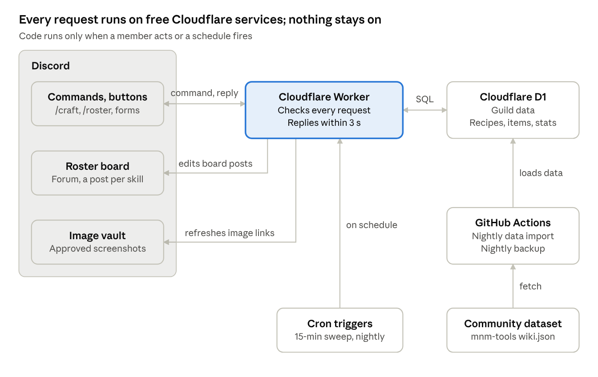

# Guild Crafting Bot — PRD & Database Schema

Oct 15, 2026 · @Joegandomi

## Overview

The guild will use a Discord bot, backed by a free hosted database, as its shared record of who can craft what. Members record skills, find crafters and browse the roster without leaving Discord. The target running cost is \$0 per month.

**Why the guild needs this.** Monsters & Memories is designed around crafters depending on each other, and a new guild has no shared record of who can make what.

- **Many skills, spread thin.** The game has about 35 tradeskills ([MNM Realm](https://mnmrealm.com/tradeskills)), and any character can train several. Each member ends up holding a small, different slice of the guild's crafting ability.

- **Recipes chain across skills.** Pelts go through Tanning before Leatherworking, and experimental magic gear requires a common crafted piece first ([tradeskills overview](https://thegameswiki.com/monsters-and-memories/wiki/tradeskills)). One finished item can need two or three crafters.

- **Skill level isn't the whole story.** Some recipes are bought from vendors, some are locked behind faction reputation, and some must be discovered (same source). Knowing who has a recipe matters as much as knowing who has the skill.

- **No marketplace search.** As of September 2026 there is no auction house or cross-zone search; the /auction channel reaches only the current zone (same source). Finding a crafter means asking the right people at the right time.

- **Chat doesn't scale.** Without a shared record, the default is asking in guild chat and waiting. Answers depend on who is online, scroll away within hours, and are never reliable enough to plan gear around.

The tool turns that scattered knowledge into one searchable, always-current answer to "who in the guild can make this?"

**Goals**

- Members record and update their own tradeskill levels per character in under 30 seconds, inside Discord.

- Anyone can type an item name and see the recipe, its trivial level and which guild members can make it.

- A read-only roster board in Discord stays current automatically, with one post per tradeskill.

- Item lookups show stat-sheet images or links where available.

- Recipe data refreshes from community sources without manual effort.

**Non-goals (v1)**

- A separate public website or in-Discord Activity (web app).

- Crafting-order workflow, payments, or material tracking.

- Support for multiple guilds (designed for, not built).

- Reading game files or logs.

**Success measures**

- At least 80% of active members have entered skills within 30 days of launch.

- Members run at least 20 item lookups a week by day 60 (the bot counts lookups in its audit log).

- Free-tier usage stays under 10% of every limit.

- Recipe data is no more than 7 days behind the community source.

## Users and use cases

Three roles cover everyone. Roles map to Discord server roles, so the guild manages access the way it already does.

| Role    | Discord mapping                 | Can do                                                                                                                                 |
|---------|---------------------------------|----------------------------------------------------------------------------------------------------------------------------------------|
| Member  | Guild member role               | Register characters, set own skill levels, mark known recipes, search and browse                                                       |
| Officer | Officer role                    | Everything a member can, plus edit or remove any member's entries, approve reports and guild recipes, and set how recipes are obtained |
| Admin   | Server admin or configured role | Configure channels and roles, trigger data refresh, rebuild the roster board                                                           |

**Core stories**

1.  As a member, I add my character and set Blacksmithing to 87 with one command.

2.  As a member, I type "Bronze Ch…", pick the item from autocomplete, and see the recipe, its components, a stat image, and who can make it.

3.  As a member, I open the roster forum, tap the Tailoring post, and see every tailor ranked by level.

4.  As a member, I run a roster command for one person and see all their skills and characters.

5.  As an officer, I remove a member who left the guild, and the board updates on its own.

6.  As a member, I flag a recipe that is wrong or missing so an officer can fix it.

## Functional requirements

The bot exposes eight member commands (`/me`, `/skills`, `/item`, `/gear`, `/roster`, `/zone`, `/request`, `/help`), `/officer` for officers and `/guildcraft` for admins, and maintains one auto-updating forum board. Every command is a slash command with autocomplete, so nobody has to remember exact item or skill names.

**Work order 18 (2026-10-21, CHECKLIST A20) renamed and merged the commands.** The tables below use the new names. Old → new:

| Old command | New |
|---|---|
| /character add, edit, remove → | `/me`: Add character, Edit character, Remove character |
| /craft set, /craft update → | `/skills` (with skill and level, or neither) |
| /craft me, /craft notify, /craft forget, a member's /craft requests → | `/me`: the panel, Notices, Forget a recipe, Cancel a request |
| /craft find, /craft know, /craft report, /item image → | `/item` (I know this recipe, Report a problem and Stat image are its buttons; `screenshot:` sends an image) |
| /gear find → | `/gear` |
| /craft request → | `/request` |
| /craft help → | `/help` |
| /recipe source, /recipe override → | `/officer recipe-source`, `/officer recipe-fix` |
| /guildcraft remove-member, an officer's /craft requests, member: on edits → | `/officer remove-member`, `/officer requests`, `/officer edit-member` |

### FR-1 Characters

| Command | Behavior |
|---|---|
| `/me` \[character\] | A private panel: the caller's characters (main marked), skills with stale markers, known recipes, request notices and open requests. Its buttons: **Add character** (name, class, level, main, race: a form; order 39: the class is picked from a menu of the game's classes), **Edit character** (rename, or change class, level, main or race), **Remove character** (soft-deletes the character and keeps its skills; the board drops it on the next refresh), **Update skills**, **Notices**, **Forget a recipe**, **Cancel a request**. A member may hold several characters. |
| `/officer edit-member` member: | Opens that member's `/me` panel for an officer; changes are recorded as the officer's. |

- The first character a member adds becomes their main. Commands that take an optional character: default to the main.

- Character names are unique per guild, case-insensitive.

### FR-2 Skills and known recipes

| Command | Behavior |
|---|---|
| `/skills` skill: level: \[character\] | Sets one tradeskill level. skill uses autocomplete, because Discord caps fixed choices at 25 and the game has about 35 tradeskills. |
| `/skills` \[character\] | With no skill and level: a tradeskill multi-select; after the member picks up to 5, a form with one level box per chosen skill. (A Discord form holds 5 inputs, so a dropdown plus a box per row would fit only 2 skills.) |
| **I know this recipe** (on `/item`) | Marks a recipe as known. Required for reputation and discovery recipes to count toward "can make" (FR-3.1); optional for vendor recipes. **Forget a recipe** on `/me` reverses it. |

- Levels are whole numbers from 0 to a configurable cap (default 300, adjustable once the game's cap is confirmed).

- Every change records who made it and when (updated_at, updated_by).

- A skill not updated in 60 days shows as "stale" on the board.

### FR-3 Find a crafter

`/item` name: returns one reply for any item (work order 18: items with no recipe too, with the recipes that use it as an ingredient):

1.  **Header:** item name, icon thumbnail, slot, and key stats (see FR-6).

2.  **Recipe:** tradeskill, trivial level, components with quantities, crafting station if known. Items with more than one recipe show each.

3.  **Crafters,** split into:

    - *Reliable:* skill ≥ trivial, sorted by level.

    - *Still learning:* within 25 points below trivial (adjustable), sorted by level. Anyone further below appears only as a count, so a level-5 skill doesn't clutter a level-200 recipe.

    - *Knows recipe:* flagged via **I know this recipe**, shown with a marker.

    - If the trivial level is unknown, all members with the tradeskill are listed by level, labeled "trivial unknown."

4.  **Buttons:** I know this recipe, Report a problem, Request a craft, Stat image, Post to channel, plus link buttons to the wiki, MnMdb and MNM Realm pages. A name the data lacks gets "No item called X" with Report a missing recipe.

**About trivial levels.** A recipe's trivial is the skill level at which it stops giving skill-ups; the community data records it for 328 of 615 recipes. The data does not record the level at which a recipe is first learned, so tiers are a guide, not a guarantee.

The reply is private by default. "Post to channel" re-posts it publicly so a member can ask for help.

### FR-3.1 Recipes gated by vendor, reputation or discovery

Skill level alone doesn't grant every recipe, so each recipe records how it is obtained, and `/item` only counts a character as able to make a gated recipe if they have marked it known. In Monsters & Memories most recipes are bought from vendors at a price tied to the skill they need, some are sold only to characters with enough faction standing, and experimental recipes are never sold and must be discovered ([tradeskills overview](https://thegameswiki.com/monsters-and-memories/wiki/tradeskills)).

| How obtained | What it means in game                                                                           | How the bot decides who can make it                                                                                                       |
|--------------|-------------------------------------------------------------------------------------------------|-------------------------------------------------------------------------------------------------------------------------------------------|
| Vendor       | Bought from a merchant or trainer; cost scales with the skill it needs                          | Skill tiers from FR-3 apply. The reply notes the recipe may need buying first, and where, if known.                                       |
| Reputation   | Sold only to characters with enough faction standing (for example the Red Mantle Quartermaster) | Only characters who marked it known count as able. Others with the skill appear as "has skill, needs reputation," with the faction named. |
| Discovery    | Experimental recipes found by testing combinations; not sold anywhere                           | Only characters who marked it known count as able. The recipe may not exist in community data at all.                                     |
| Unknown      | Not recorded yet                                                                                | Skill tiers from FR-3 apply, with a note to confirm the crafter has the recipe.                                                           |

- **Starting point.** The community data doesn't record how recipes are obtained, so every imported recipe starts as Unknown. Officers set the real value with `/officer recipe-source` item: how: \[faction\] \[note\], and member reports feed the same queue. These corrections survive the nightly import, like overrides.

- **One-click marking.** Every `/item` reply for a craftable item has an "I know this recipe" button, so marking a gated recipe takes one click from the place a member sees it.

- **Discovered recipes.** `/recipe add` (not built yet: after launch) lets a member record a recipe the community data lacks: tradeskill, result item, components and trivial if known. An officer approves it before it appears. It is **guild-private by default**, visible only to this guild and never shared upstream, so the guild keeps its discoveries. An officer can make it public later.

- **Who knows the rare ones.** `/roster recipes` \[skill\] lists every reputation and discovery recipe that at least one guild character has marked known, and who knows it.

- **Out of scope.** The bot doesn't track each character's faction standing. For reputation recipes it names the faction so members know what to work toward.

### FR-4 Roster commands

| Command | Behavior |
|---|---|
| `/roster skill` skill: \[min_level\] | Ranked list of every character with that tradeskill, 15 per page, with Previous/Next buttons and a dropdown to switch tradeskill. |
| `/roster member` member: @user | All of one member's characters and skills, grouped by character. |
| `/roster top` | The top 3 characters in each tradeskill, one compact list. (The rare-recipe roster, `/roster recipes`, is in FR-3.1.) |
| `/gear` class: … | Gear for a class, by slot, weapon type, AC, ratio, stats, source and zone (work order 13). |
| `/zone` name: | A zone's card: level range, creatures, and links to the wikis and MnM Atlas (work order 17). |
| `/request` item: \[quantity\] \[note\] | Asks the opted-in crafters who can make an item, in a private thread (work order 16). |
| `/help` | A guide in pages, one button per page. |

Discord dropdowns hold at most 25 options, so the tradeskill switcher lists only skills with at least one member, split alphabetically across two dropdowns (A–M, N–Z) when more than 25 are in use.

### FR-5 Roster board (forum channel)

- An admin runs `/guildcraft setup` board:#forum-channel once. The bot creates one forum post per tradeskill, titled with the skill name only. The member count lives in the post body, because Discord tightly rate-limits renaming channels and threads.

- Each post's first message is a ranked list (rank, character, member, level, stale marker), owned and edited only by the bot. Members can reply in the post, for example to request crafts.

- When a skill changes, the bot marks that tradeskill "dirty" and rewrites its post within about 1 minute. A scheduled sweep every 15 minutes catches anything missed, and a nightly job rebuilds every post.

- A Discord message holds about 6,000 characters of embed text, roughly 150 roster lines. Larger lists continue in bot-owned follow-up messages in the same post.

- A pinned "Index" post links to every tradeskill post and shows last-refresh time. While a board fills it also shows one line with how many of its posts exist and about how long the rest will take (order 30).

- A forum GuildCraft creates gets short post guidelines saying what it holds and that GuildCraft writes its posts. GuildCraft never touches them after that, so officers can change them (order 30).

### FR-6 Item stats and images

- Item stats come from the community dataset (slot, AC, damage/delay, stats, resists, weight, classes, races) and render as embed fields with the item icon as thumbnail.

- Members can submit a screenshot of the in-game item window with `/item` name: screenshot:. Officers approve it with one button before it shows publicly.

- Every item reply links to its wiki, MnMdb and MNM Realm pages. The Item stats and images section covers sources and storage.

### FR-7 Data quality

- **Report a problem** on an `/item` card files a report (wrong trivial, wrong components, wrong source, missing recipe, other; or, for item data, wrong stats, source or class) into an officer review queue channel with Mark fixed/Dismiss buttons. A name the data lacks can be reported as a missing recipe. The officer fixes the data with `/officer recipe-fix` or `/officer recipe-source`; the buttons only record the outcome. (Amended by work order 9, override 4: "wrong source" and "other" added; the buttons were "Approve/Dismiss".)

- Officers can override an existing recipe's trivial or components with `/officer recipe-fix`, for their own server only. Overrides survive the nightly re-import. (Work order 9: adding a recipe, `/recipe add`, moves to after launch.)

### FR-8 Administration

| Command | Who | Behavior |
|---|---|---|
| `/guildcraft setup` | Admin | Sets board channel, review, vault and request channels, member role and officer role. |
| `/guildcraft rebuild-board` | Admin | Forces a full board rebuild. |
| `/guildcraft status` | Admin | Shows data version, last import, last board refresh and free-tier usage. |
| `/officer remove-member` member: | Officer | Removes a departed member's characters and skills. |
| `/officer edit-member` member: | Officer | Opens that member's `/me` panel (FR-1). |
| `/officer recipe-source`, `/officer recipe-fix` | Officer | How a recipe is obtained; its trivial or ingredients (FR-3.1, FR-7). |
| `/officer requests` | Officer | Every open craft request, paged, with Cancel. |

`/officer` and `/guildcraft` are shown to Manage Server by default; a server admin grants `/officer` to the officer role once (Server Settings → Integrations → the app → `/officer`).

A member's record is created or refreshed the first time they use the bot. The nightly job compares that list with the server's current members (this needs the Server Members intent) and flags anyone who left for officer review. Data is never deleted automatically.

Officer and admin commands are hidden from regular members using Discord's default command permissions, and the Worker re-checks the caller's roles on every request, so hiding a command is never the only safeguard.

### FR-9 Onboarding

- The first time a member uses any command, the bot replies privately with a three-step welcome: add a character, set skills, try a lookup.

- `/help` shows a guide to every command, in pages with a button for each (work order 18; it was one screen).

- The board's index post explains how to get listed, so new recruits can join the roster on their own.

## Recommended tech stack

The whole system runs on free tiers at \$0 per month with no credit card: Discord's HTTP interactions, one Cloudflare Worker, a Cloudflare D1 database, and a GitHub Actions job for data imports. Nothing runs around the clock, so there is no server to host or pay for.

| Layer              | Choice                                                                                                         | Why                                                                                                                                                     | Free-tier limit                                                                  | Expected use (50-member guild) |
|--------------------|----------------------------------------------------------------------------------------------------------------|---------------------------------------------------------------------------------------------------------------------------------------------------------|----------------------------------------------------------------------------------|--------------------------------|
| Chat interface     | Discord app with slash commands, buttons, forms                                                                | Members never leave Discord; Discord handles login and roles                                                                                            | Free                                                                             | n/a                            |
| Request handling   | [Cloudflare Workers](https://developers.cloudflare.com/workers/platform/limits/) (TypeScript)                  | Discord can call it directly over HTTPS; official Discord tutorial exists                                                                               | 100,000 requests/day, 10 ms CPU/request, 50 subrequests/request, 5 cron triggers | ~1,000 requests/day            |
| Database           | [Cloudflare D1](https://freetier.co/articles/cloudflare-d1-free-tier-limits-pricing-and-alternatives) (SQLite) | Same account as the Worker; plain SQL; no pausing when idle                                                                                             | 5 GB storage, ~5M row reads/day, ~100K row writes/day                            | \< 20 MB, \< 100K reads/day    |
| Scheduled jobs     | Workers cron triggers                                                                                          | Board sweep every 15 min, nightly rebuild                                                                                                               | 5 per account                                                                    | 2 used                         |
| Data import        | GitHub Actions in a public repo                                                                                | Parses the 3 MB community dataset outside the Worker's 10 ms CPU budget, then writes only changed rows to D1 using an API token kept as a GitHub secret | Free for public repos                                                            | 1 run/night, ~2 min            |
| Item image storage | Private Discord "vault" channel                                                                                | Stores approved screenshots at no cost and no card                                                                                                      | Free                                                                             | \< 1,000 images                |
| Source control     | GitHub (public repo)                                                                                           | Free Actions minutes; guild members can contribute                                                                                                      | Free                                                                             | n/a                            |
| Libraries          | discord-interactions (request signing), Hono or itty-router (routing), Drizzle or raw SQL                      | Small, Workers-compatible                                                                                                                               | Free                                                                             | n/a                            |

**Why not the alternatives**

- **Always-connected bot (discord.js on a VPS):** needs a server running 24/7, and free hosting for those has largely disappeared. HTTP interactions do everything this PRD needs.

- **Supabase:** a good database, but free projects pause after 7 days of low activity, which would break the bot during quiet weeks ([Supabase docs](https://supabase.com/docs/guides/platform/free-project-pausing)).

- **Cloudflare R2 for images:** 10 GB free with free egress ([R2 pricing](https://developers.cloudflare.com/r2/pricing/)), but activating R2 requires adding a credit card or PayPal ([setup guide](https://eastondev.com/blog/en/posts/dev/20251130-r2-picgo-setup/)). It is the upgrade path if the vault channel proves awkward.

- **Airtable / Google Sheets as the database:** record caps and API rate limits, and a shared spreadsheet is hard to read, search and keep current as a guild grows.

**Cost ceiling.** If the guild ever outgrew the free tier, Workers Paid is \$5 per month and covers D1 well past any guild's needs. At current estimates usage stays under 2% of free limits.

## Architecture and data flows

One Cloudflare Worker sits between Discord and the database and runs only when called. Discord calls it when a member uses a command; cron triggers call it on a schedule; a separate GitHub Actions job loads recipe data.

System architecture · Discord, one Worker, D1, scheduled jobs

**Command flow.** Discord sends each command to the Worker, which verifies Discord's signature, queries D1 and replies within 3 seconds. After a skill change it replies first, then marks that tradeskill's board post dirty and rewrites it in the background.

**Board flow.** Cron runs every 15 minutes to rewrite any dirty posts, and nightly to rebuild all of them. Posts whose content hash is unchanged are skipped, which keeps Discord API calls low.

**Data flow.** Each night GitHub Actions downloads the community dataset, checks its structure, converts it to SQL upserts and loads D1. Parsing happens there because the 3 MB file would exceed the Worker's 10 ms CPU budget. The same job exports a database backup.

## Database schema

The schema has 14 tables in two groups. Game reference data (tradeskills, items, recipes) is shared and replaced by the nightly import. Guild data (members, characters, skills, board state) is keyed by Discord server ID, so a second guild could use the same bot later without changes.

| Table            | Group     | Holds                                                                                         | Written by        |
|------------------|-----------|-----------------------------------------------------------------------------------------------|-------------------|
| tradeskill       | Reference | The ~35 tradeskills, crafting or gathering                                                    | Import            |
| item             | Reference | Item name, icon, stats, external links                                                        | Import            |
| recipe           | Reference | Result item, tradeskill, trivial, how it's obtained, source (wiki, override or guild-private) | Import, officers  |
| recipe_component | Reference | Ingredients and quantities per recipe                                                         | Import, officers  |
| guild            | Guild     | Server settings: channels, roles, skill cap                                                   | Admin             |
| member           | Guild     | Discord users in the guild, active or left                                                    | Bot               |
| character        | Guild     | Characters per member, main flag                                                              | Members           |
| character_skill  | Guild     | Level per character per tradeskill                                                            | Members           |
| character_recipe | Guild     | Recipes a character has marked as known                                                       | Members           |
| item_image       | Guild     | Submitted stat screenshots and approval state                                                 | Members, officers |
| recipe_report    | Guild     | Data-quality reports and their resolution                                                     | Members, officers |
| board_post       | Guild     | Forum post and message IDs per tradeskill, dirty flag                                         | Bot               |
| data_import      | System    | Each import run: source version, counts, status                                               | Import            |
| audit_log        | System    | Who changed what, when                                                                        | Bot               |

-- ============ Reference data (shared, refreshed nightly) ============  
CREATE TABLE tradeskill (  
id INTEGER PRIMARY KEY,  
name TEXT NOT NULL UNIQUE, -- 'Blacksmithing'  
kind TEXT NOT NULL CHECK (kind IN ('crafting','gathering')),  
sort_order INTEGER NOT NULL DEFAULT 0  
);  
  
CREATE TABLE item (  
id INTEGER PRIMARY KEY,  
name TEXT NOT NULL,  
name_key TEXT NOT NULL UNIQUE, -- lower(name), for autocomplete  
icon_url TEXT, -- wiki icon, 64 px  
slot TEXT,  
stats_json TEXT, -- {ac, dmg, delay, hp, mana, stats{}, resists{}, weight, size, class, race, flags\[\]}  
wiki_url TEXT,  
mnmdb_url TEXT,  
mnmrealm_url TEXT,  
source TEXT NOT NULL DEFAULT 'wiki',  
imported_at TEXT NOT NULL  
);  
  
CREATE TABLE recipe (  
id INTEGER PRIMARY KEY,  
source_key TEXT NOT NULL UNIQUE, -- tradeskill + result item (+ variant \#); stable when components change  
tradeskill_id INTEGER NOT NULL REFERENCES tradeskill(id),  
result_item_id INTEGER NOT NULL REFERENCES item(id),  
result_qty INTEGER NOT NULL DEFAULT 1,  
trivial INTEGER, -- NULL = unknown  
station TEXT,  
acquisition TEXT NOT NULL DEFAULT 'unknown'  
CHECK (acquisition IN ('vendor','reputation','discovery','unknown')),  
faction TEXT, -- reputation recipes: faction that sells it  
acquisition_note TEXT, -- vendor name, standing needed, discovery hint  
source TEXT NOT NULL CHECK (source IN ('wiki','override','guild')),  
guild_id TEXT, -- set = guild-private recipe added by members  
active INTEGER NOT NULL DEFAULT 1, -- 0 = superseded, removed upstream, or awaiting approval  
imported_at TEXT NOT NULL  
);  
CREATE INDEX recipe_by_result ON recipe(result_item_id) WHERE active = 1;  
  
CREATE TABLE recipe_component (  
recipe_id INTEGER NOT NULL REFERENCES recipe(id) ON DELETE CASCADE,  
item_id INTEGER NOT NULL REFERENCES item(id),  
qty INTEGER NOT NULL,  
PRIMARY KEY (recipe_id, item_id)  
);  
  
-- ============ Guild data (keyed by Discord server) ============  
CREATE TABLE guild (  
id TEXT PRIMARY KEY, -- Discord guild (server) ID  
name TEXT NOT NULL,  
board_channel_id TEXT, -- forum channel  
review_channel_id TEXT,  
vault_channel_id TEXT, -- private channel holding approved images  
member_role_id TEXT,  
officer_role_id TEXT,  
skill_cap INTEGER NOT NULL DEFAULT 300,  
stale_days INTEGER NOT NULL DEFAULT 60,  
created_at TEXT NOT NULL  
);  
  
CREATE TABLE member (  
guild_id TEXT NOT NULL REFERENCES guild(id),  
discord_user_id TEXT NOT NULL,  
display_name TEXT NOT NULL,  
status TEXT NOT NULL DEFAULT 'active' CHECK (status IN ('active','left')),  
first_seen_at TEXT NOT NULL,  
PRIMARY KEY (guild_id, discord_user_id)  
);  
  
CREATE TABLE character (  
id INTEGER PRIMARY KEY,  
guild_id TEXT NOT NULL,  
owner_user_id TEXT NOT NULL,  
name TEXT NOT NULL,  
name_key TEXT NOT NULL, -- lower(name)  
class TEXT,  
level INTEGER,  
is_main INTEGER NOT NULL DEFAULT 0,  
deleted_at TEXT,  
created_at TEXT NOT NULL,  
updated_at TEXT NOT NULL,  
FOREIGN KEY (guild_id, owner_user_id) REFERENCES member(guild_id, discord_user_id),  
UNIQUE (guild_id, name_key)  
);  
CREATE INDEX character_by_owner ON character(guild_id, owner_user_id);  
  
CREATE TABLE character_skill (  
character_id INTEGER NOT NULL REFERENCES character(id) ON DELETE CASCADE,  
tradeskill_id INTEGER NOT NULL REFERENCES tradeskill(id),  
level INTEGER NOT NULL CHECK (level \>= 0),  
updated_at TEXT NOT NULL,  
updated_by TEXT NOT NULL, -- Discord user ID (owner or officer)  
PRIMARY KEY (character_id, tradeskill_id)  
);  
CREATE INDEX skill_ranking ON character_skill(tradeskill_id, level DESC);  
  
CREATE TABLE character_recipe (  
character_id INTEGER NOT NULL REFERENCES character(id) ON DELETE CASCADE,  
recipe_id INTEGER NOT NULL REFERENCES recipe(id),  
created_at TEXT NOT NULL,  
PRIMARY KEY (character_id, recipe_id)  
);  
  
CREATE TABLE item_image (  
id INTEGER PRIMARY KEY,  
guild_id TEXT NOT NULL,  
item_id INTEGER NOT NULL REFERENCES item(id),  
vault_message_id TEXT, -- message in the vault channel  
attachment_id TEXT, -- used to refresh the expiring CDN URL  
cached_url TEXT,  
cached_url_expires_at TEXT,  
submitted_by TEXT NOT NULL,  
status TEXT NOT NULL DEFAULT 'pending' CHECK (status IN ('pending','approved','rejected')),  
reviewed_by TEXT,  
created_at TEXT NOT NULL  
);  
CREATE INDEX image_by_item ON item_image(guild_id, item_id, status);  
  
CREATE TABLE recipe_report (  
id INTEGER PRIMARY KEY,  
guild_id TEXT NOT NULL,  
item_id INTEGER REFERENCES item(id),  
recipe_id INTEGER REFERENCES recipe(id),  
reporter TEXT NOT NULL,  
issue TEXT NOT NULL,  
status TEXT NOT NULL DEFAULT 'open' CHECK (status IN ('open','fixed','dismissed')),  
resolved_by TEXT,  
created_at TEXT NOT NULL,  
resolved_at TEXT  
);  
  
CREATE TABLE board_post (  
guild_id TEXT NOT NULL,  
tradeskill_id INTEGER NOT NULL REFERENCES tradeskill(id),  
thread_id TEXT NOT NULL, -- forum post  
message_ids_json TEXT NOT NULL, -- ordered bot-owned messages: \[first, ...overflow\]  
content_hash TEXT, -- skip edits when nothing changed  
dirty INTEGER NOT NULL DEFAULT 1,  
last_rendered_at TEXT,  
PRIMARY KEY (guild_id, tradeskill_id)  
);  
  
-- ============ System ============  
CREATE TABLE data_import (  
id INTEGER PRIMARY KEY,  
source TEXT NOT NULL, -- 'mnm-tools/wiki.json'  
source_version TEXT NOT NULL, -- dataset generatedAt or commit SHA  
items INTEGER, recipes INTEGER,  
status TEXT NOT NULL, -- 'ok' \| 'failed'  
error TEXT,  
started_at TEXT NOT NULL,  
finished_at TEXT  
);  
  
CREATE TABLE audit_log (  
id INTEGER PRIMARY KEY,  
guild_id TEXT NOT NULL,  
actor TEXT NOT NULL,  
action TEXT NOT NULL, -- 'skill.set', 'character.remove', 'craft.find', ...  
target TEXT,  
detail_json TEXT,  
created_at TEXT NOT NULL  
);

**The core query.** `/item` (formerly /craft find) answers "who can make this?" in one indexed query:

SELECT r.id AS recipe_id, r.acquisition, r.faction, c.name AS character, m.display_name AS member, cs.level, r.trivial,  
CASE WHEN r.acquisition IN ('reputation','discovery')  
AND NOT EXISTS (SELECT 1 FROM character_recipe k  
WHERE k.character_id = c.id AND k.recipe_id = r.id)  
THEN 'recipe not confirmed'  
WHEN r.trivial IS NULL THEN 'trivial unknown'  
WHEN cs.level \>= r.trivial THEN 'reliable'  
ELSE 'still learning' END AS tier,  
EXISTS (SELECT 1 FROM character_recipe cr  
WHERE cr.character_id = c.id AND cr.recipe_id = r.id) AS knows_recipe  
FROM recipe r  
JOIN character_skill cs ON cs.tradeskill_id = r.tradeskill_id  
JOIN character c ON c.id = cs.character_id AND c.deleted_at IS NULL  
JOIN member m ON m.guild_id = c.guild_id AND m.discord_user_id = c.owner_user_id  
WHERE r.result_item_id = ?1 AND r.active = 1  
AND (r.guild_id IS NULL OR r.guild_id = ?2) -- shared + this guild's private recipes  
AND c.guild_id = ?2 AND m.status = 'active'  
ORDER BY CASE tier WHEN 'reliable' THEN 1 WHEN 'still learning' THEN 2  
WHEN 'trivial unknown' THEN 3 ELSE 4 END,  
knows_recipe DESC, cs.level DESC;  
-- The 25-point "still learning" window and the count of lower-skill members are applied in code.

**Design notes**

- Item autocomplete is a prefix range scan on item.name_key (about 5,350 items), well under the 3-second reply limit.

- Officer corrections are a guild-scoped layer (work order 9, override 2; migration 0009): recipe_correction, keyed (guild_id, recipe_id), holds a guild's acquisition, faction, note and trivial, and recipe_correction_component its corrected component list, which replaces the whole imported list for that guild. Readers use the guild's value where one is set and the imported value otherwise; the import never touches the layer. One deployment serves many guilds, so corrections are never written to the shared recipe row. This replaces the earlier design (override rows with source = 'override', the wiki recipe set to active = 0); source = 'override' is unused, and recipe.acquisition stays at its default, unknown.

- Discord IDs are stored as TEXT because they exceed JavaScript's safe integer range.

- Timestamps are ISO-8601 UTC strings, SQLite's convention.

Recipes missing from the latest import are set to active = 0, never deleted, so members' known-recipe marks survive upstream changes. An item with several recipes returns one group of rows per recipe_id.

## Item stats and images

Item stats can be shown for most craftable items at no cost, using three layers: structured stats rendered as Discord fields, the wiki icon as a thumbnail, and optional member-submitted screenshots. Links to three fan databases cover anything the bot doesn't show.

**Coverage today.** In the community dataset (5,349 items, refreshed 2026-10-14), the 595 distinct craftable results break down as follows:

| Data available             | Craftable items | Share |
|----------------------------|-----------------|-------|
| Matching item record       | 467             | 78%   |
| Icon image                 | 417             | 70%   |
| Stats, AC or damage values | 300             | 50%   |

Many items without stats are components (bars, thread, leather), which have no combat stats anyway.

### Layer 1: stats as embed fields (default)

- The import stores each item's slot, AC, damage/delay, HP/mana, attribute stats, resists, weight, size, classes, races and flags in item.stats_json.

- The bot renders them as compact embed fields (for example AC 2 · FACE · 0.4 wt · ALL/ALL). This is searchable, copyable text and works on phones.

- The item icon (64 px, hosted by the wiki) is the embed thumbnail. The footer credits the source: "Item data: Monsters and Memories Wiki, CC BY-SA 4.0."

### Layer 2: member screenshots of the in-game item window

- `/item` name: screenshot: accepts an image attachment. The bot re-posts it to a private vault channel and files it as pending; officers approve or reject with a button.

- Discord attachment links now expire. Each link carries an expiry timestamp and stops working after it passes. The bot gets a fresh one by reading the vault message again (Get Channel Message): Discord's reference says "when your app receives a payload with a signed URL (like when you fetch a message), it will be valid" ([Signed Attachment CDN URLs](https://docs.discord.com/developers/reference)). (Amended by work order 9, override 5: the refresh-urls endpoint named here before is not in Discord's reference and is not used.)

- The bot therefore stores the vault message and attachment IDs, caches the current link with its expiry, and refreshes it on demand. Storage stays free and needs no credit card.

- The "Stat image" button on `/item` shows the approved screenshot, or says none exists yet and invites a submission.

- Upgrade path: copy approved images to Cloudflare R2 for permanent links, if the guild accepts adding a payment method.

### Layer 3: external links

Every item reply carries link buttons to the item's page on each site. URL patterns are computed during import and verified by a link check in the import job.

| Site                                                                    | What it adds                               | Link pattern                 |
|-------------------------------------------------------------------------|--------------------------------------------|------------------------------|
| [Monsters and Memories Wiki](https://monstersandmemories.miraheze.org/) | Full item page, drop sources, player notes | /wiki/\<Item_Name\>          |
| [MnMdb](https://mnm-db.com/)                                            | Drop rates, vendor and auction prices      | /#/item/\<id\>               |
| [MNM Realm](https://mnmrealm.com/)                                      | Related recipes, NPCs, quests              | /items/\<slug\> (to confirm) |

**Not in v1.** A generated stat-card image (an in-game-style tooltip drawn as a PNG) is possible later. It would be rendered by the import job rather than the Worker, to stay inside the 10 ms CPU limit.

## Constraints, risks and delivery plan

The design fits inside Discord's interaction limits and Cloudflare's free tier with wide margins. The main risk is recipe data quality, not cost or scale.

### Non-functional requirements

- **Speed:** commands reply in under 1 second at the 95th percentile; anything slower shows Discord's "thinking…" state first.

- **Cost:** \$0 per month; /guildcraft status reports usage against each free limit.

- **Privacy:** stores only Discord user IDs, display names, character names and skill data. No game account data and no message content.

- **Backup:** the nightly job exports the database to a separate private GitHub repository (the code repository stays public), so a lost account loses at most one day of changes.

- **Bus factor:** at least two guild members have admin access to the Discord app, the Cloudflare account and the GitHub repo.

- **Attribution:** replies credit the wiki (CC BY-SA 4.0); the README credits mnm-tools (MIT).

### Discord limits the design respects

| Limit                  | Value                       | How the design handles it                                   |
|------------------------|-----------------------------|-------------------------------------------------------------|
| First reply deadline   | 3 seconds                   | Defer, then edit; the find query is a single indexed lookup |
| Follow-up window       | 15 minutes per interaction  | Page buttons start a new interaction each click             |
| Autocomplete choices   | 25                          | Prefix search returns the top 25 matches                    |
| Dropdown options       | 25                          | Tradeskill switcher split A–M and N–Z                       |
| Embed text per message | 6,000 characters, 10 embeds | Board overflows into extra bot-owned messages               |
| Plain message text     | 2,000 characters            | All formatted output uses embeds                            |

Sources: [interactions](https://docs.discord.com/developers/interactions/receiving-and-responding), [message and embed limits](https://docs.discord.com/developers/resources/message), [components](https://docs.discord.com/developers/components/reference).

**Bot permissions:** View Channel, Send Messages, Send Messages in Threads, Create Public Threads, Manage Threads (board channel only), Embed Links, Attach Files, Read Message History. Detecting members who left the server needs the Server Members intent switched on in the developer portal.

### Risks

| Risk                                               | Impact                                          | Mitigation                                                                                                                               |
|----------------------------------------------------|-------------------------------------------------|------------------------------------------------------------------------------------------------------------------------------------------|
| Only 328 of 615 recipes have a known trivial level | "Who can make it" is fuzzy for half the recipes | "Trivial unknown" tier, member reports, officer overrides                                                                                |
| Recipes change with Early Access patches           | Stale results                                   | Nightly import; data version shown in replies                                                                                            |
| Community dataset changes format or disappears     | Import breaks                                   | Schema check before load; keep last good data; post failures to the review channel; fallback importer that reads the wiki's API directly |
| A Discord or Cloudflare limit changes              | Feature or cost change                          | Usage shown in /guildcraft status; \$5/month fallback                                                                                    |
| One person maintains it                            | Bot dies when they leave                        | Public repo, setup guide, two admins                                                                                                     |
| Members don't keep levels current                  | Board goes stale                                | Stale markers; officer prompt for skills older than 60 days                                                                              |

### Open questions

- [ ] How many members and characters does the guild have? This decides board pagination.

- [ ] What is the game's tradeskill cap, and should gathering skills appear on the board?

- [ ] Who owns the Discord app, Cloudflare account and GitHub repo?

- [ ] Should screenshots and member-added recipes need officer approval, and should added recipes stay guild-private by default (proposed: yes to both)?

- [ ] Should /craft find reply privately or publicly by default?

- [ ] Ask the mnm-tools maintainer for permission to consume their dataset, as a courtesy.

### Delivery plan

1.  **Foundation:** a test Discord server and separate dev database, then the Discord app, Worker, D1 schema and nightly import job; /character and /craft set, /craft update, /craft me.

2.  **Search:** /craft find with stats, icon, links and crafter tiers; /roster skill, /roster member, /roster top.

3.  **Board:** forum posts per tradeskill, dirty-flag refresh, 15-minute sweep, nightly rebuild, index post.

4.  **Quality and images:** reports, overrides, known recipes, recipe sources (FR-3.1), guild-private recipes, screenshot vault with approval.

5.  **Launch:** announce the bot, pin the help guide, and run a sign-up push so the board fills in during the first week.

## DKP add-on (orders 27–28)

Approved by the owner on 2026-10-29. DKP is an optional add-on that a server's admin adds or removes with **Add DKP module** and **Remove DKP module** in `/guildcraft setup`. Points are paid for each named kill a member is present for (ticks). Points are kept per raid zone. The rules guard against leadership bias and against banking points before leaving.

**Principles.** The bot decides, and officers correct in public with a reason. Points are earned for being present when it matters. Points are spent only where they were earned (order 28). Every rule is a setting with a default.

**Pools.**

- Each raid zone, picked from GuildCraft's zone list, is its own raid pool.
- The guild pool is earned at a smaller rate, and order 28's shop spends it.
- Points belong to the member (the Discord user), not to a character. Everyone starts at zero.

**Who earns: members and frozen members.**

- Tapping a raid button refreshes the member's row, as a slash command does. The member-role gate applies, and a member without that role is refused privately.
- A member whose status is 'left' is frozen. They earn nothing, and the standings show them as frozen.
- A frozen member thaws on their own next command or raid-button press.
- An officer's Remove freezes a member the same way, until they come back by themselves.
- "Leaving the server" means the nightly run's mark. A member who left today keeps the state they had until that run.

**Raid night.** One raid is open per server at a time.

- *Opening.* An officer runs `/dkp raid zone: mode:` (per named kill, or flat), and the bot posts a raid card in GC-DKP. If a raid is already open, the command is refused with a link to it.
- *Checking in.*
  - Members tap Present, or Standby if they are held outside a full raid.
  - Their state carries over to every later kill until they tap Leaving or an officer changes it.
  - Tapping Present after a kill does not earn that kill, only later ones.
- *Named killed.*
  - The button offers the zone's creatures in a select menu: the first 25 in display order. Order 28's override 4 (shipped in order 28b): raid encounters first, then named mobs, then "Other creatures", each part A→Z, from the wiki's own tags (Category:Raid Encounters, Category:Named Mobs; `npc.raid`, `npc.named`). Each option names its part under its label. Nothing is inferred from a name.
  - `/dkp kill named:` covers every creature, with autocomplete. It also accepts a typed name, stored as typed, for creatures the data doesn't list.
  - The creature list is the union of the zone's mobs and NPCs, deduplicated by case-insensitive name, without merchants.
  - A zone with no creatures shows no select menu; the card says to use `/dkp kill`.
  - The same named recorded twice within 2 minutes asks the officer to confirm it was a respawn. Otherwise each record is a kill.
- *Payout.*
  - Everyone Present at that moment earns the named's raid points and the guild points. Order 29: everyone Standby at that moment goes on the kill's roster and earns the standby value once, at close (below); a raid opened before order 29 keeps the old rule (Standby earned each kill).
  - The kill line on the card shows the named, the points, how many earned, and the changes against the previous kill (for example +Kestrel −Pip).
  - Who earned answers privately with the full list.
- *Kill roll call* (officer, per kill).
  - For the window (default 300 seconds), members credited on that kill tap Present again to keep it.
  - Those who don't are removed from that kill when the window closes. They are then absent for later kills until they tap Present.
  - A member who first taps Present inside the window doesn't gain that kill; an officer correction can add them.
- *Corrections.*
  - An officer adds or removes a member on a kill, or on the whole raid. The reason is required and shown.
  - A correction whose total is over 20 points needs a second officer, as adjustments do.
- *Flat mode.* There is no Named killed. Pay attendance pays the flat value once, to everyone Present at that moment; Standby at that moment earns the standby value once, at close (order 29).
- *Closing.*
  - Close raid posts the night's summary and refreshes the standings.
  - A raid nobody closes closes itself after 8 hours.
  - If DKP is removed mid-raid, the raid closes at once, its timers are cancelled, and its buttons answer "DKP is off on this server".

**Card size.**

- The raid card shows names only up to a limit. Beyond it, the card shows counts, plus Who's here and Who earned buttons that answer privately.
- Standings are one message per pool, showing the top members, with Full standings answering privately and paged.

**Adjustments.**

- `/dkp adjust member: pool: points: reason:` takes a reason, which is required, and the change is posted publicly in GC-DKP.
- A change over 20 points (either sign) posts an approval card instead. Another officer presses Approve within 24 hours, or it lapses.
- Nobody changes, or approves a change to, their own points.

**Settings.**

- `/dkp settings` is admin only. Each change is posted publicly and applies from then on.
- `/dkp named-value zone: named: points:` is for officers. It is posted publicly and applies from then on.

| Setting | Default |
|---|---|
| Raid points per named kill | 10 |
| Flat raid value | 30 |
| Guild points per kill or flat payout | 2 |
| Pool cap | 200 (order 29; it was 100) |
| Standby value (order 29) | 30 |
| Wins per raid (order 29) | 2 |
| Wins per 7 days (order 29) | 4 |
| New-member wait (order 29) | 3 kills in that pool |
| Raid auction length (order 29) | 180 seconds |
| General auction length (order 29) | 24 hours |
| Decay after (order 29) | 180 idle days |
| Decay per week (order 29) | 10% |
| Wishlist size (order 29) | 30 items |
| Kill roll call window | 300 seconds |
| Second officer needed | over 20 points |
| Approval lapses after | 24 hours |
| Raid auto-closes after | 8 hours |
| Who runs DKP | the officer role (and admins) |

**Seeing points.** Points are public within the server.

- Standings messages sit at the top of GC-DKP, one per pool. They are edited after each raid closes and after each adjustment.
- 30-day attendance is the kills (and flat payouts) a member earned in a pool, divided by those the pool held, over the last 30 days.
- `/dkp history member: pool:` answers privately: ledger rows, newest first, paged.
- `/me` shows balances per pool and 30-day attendance, where DKP is on.

**Order 29: spending points** (approved by the owner on 2026-10-29, 16:08 and 16:12 ET). The bot decides every auction: bids stay hidden from everyone until close, closing is by timer only, and the price is computed. Every spend, refund, standby payout and decay is a ledger row; balances stay derived.

- *Standby* (raids opened from order 29 on). A member who is Standby at one or more kills (or at a flat raid's Pay attendance) earns the standby value once (its own setting, default 30), paid when the raid closes, with the guild points for that payout. The raid closes this way however it closes: an officer, auto-close, or Remove DKP module. Mixed attendance: the per-kill points for the Present kills, plus the standby value once. Removing a member's last Standby kill before close means no standby pay; after close, a correction row reverses the standby row. The pool cap applies.
- *Cap.* The default is 200. A server's admin can set it to anything in `/dkp settings`; servers that never changed it get 200 at once.
- *Who was at a kill* is the kill's roster (who was Present or Standby), written with the kill and updated by Kill roll call and corrections.
- *Raid auctions.*
  - Starting one: from the raid card, **Auction a drop** offers the latest kill's known loot (the named's loot names matched to items, at most 25), or `/dkp auction item:` picks any item. A raid auction needs an open raid; with none, the reply points to the general auction. The officer can set a minimum bid (default 1) and a duration (default 3 minutes). The card shows the item's stats (the `/item` card).
  - Who may bid: a member Present or Standby at one or more kills of that raid (points belong to the member, so the item can go to any of their characters), under the win limits (2 per raid, 4 in any 7 days; general-auction wins count only toward the 7 days; shop purchases toward neither), past the new-member wait (3 kills, Present or Standby, in that raid zone's pool, ever), and not frozen. One function decides this.
  - Bidding: **Bid** opens a form for an amount: a whole number, at least the minimum, at most the member's balance in that raid's pool. A bid counts only if it arrives before the close time by the server's clock. While the auction is open a member can raise, lower or withdraw their bid. Nobody sees any bid, officers included; the card shows only the number of bidders.
  - Closing: on the timer only, with no extension. Every bid is checked again against the bidder's balance; one that can no longer be paid is dropped, and the result says so. The price is the second-highest valid bid + 1, never more than the winner's own bid; a lone bidder pays the minimum. A tie goes to the higher 30-day attendance in that pool, then to the earlier bid. The winner's points come off as a spend row. The result is posted with every bid revealed (members shown, nobody pinged) and the price.
  - Cancel (order 31): an officer can cancel an open auction with `/dkp cancel auction: reason:`, unless they have bid in it. The reason is required; the cancellation is public and reveals the bids. There's no spend. The card has no Cancel button, because Discord can't hide a button from some viewers.
  - An auction open when its raid closes runs to its timer. Remove DKP module cancels every open auction ("DKP removed", bids revealed) before the timers are cleared. An auction with no bids offers **Post to general auction**.
- *The general auction.* An officer posts any item, or one that went unsold, for guild points. Every active member may bid: no presence rule and no new-member wait, but the win limits count. The same sealed bids, price rule and timer, 24 hours by default. If it expires unsold, the officer records what was done with the item (free text, public), and the record is kept.
- *The item queue.* From the raid card, an officer can queue several drops: each auction opens as the one before it closes. The raid card keeps a Won tonight list (item, winner, price).
- *Wishlists.* `/dkp wishlist add item: character:`, `/dkp wishlist remove item:` and `/dkp wishlist show member:`. Wishlists are public within the server, at most 30 items each. Adding an item is the member's opt-in to a direct message: when an auction opens for it, every eligible member who wishes for it gets one (a link to the auction card, not a Bid button), and the card shows "wanted by N eligible". A member who refuses direct messages is skipped and counted.
- *The shop* (fixed prices, guild points). `/dkp shop add item: price: quantity: per_member:` posts a listing with **Buy**: first come, first served; each purchase is a spend row and is posted. Officers can't buy from a listing they posted. An officer can close a listing early.
- *Decay.* Once a week, any pool balance whose member has had no ledger row other than decay in that pool for 180 days loses 10% (rounded down, at least 1 while the balance is above 0), as a decay row by the bot. It stops as soon as the member earns or spends in that pool again. Frozen members decay too. A server with DKP on always has exactly one weekly decay timer: Add DKP module sets it, and a daily check restores it if it is ever missing (order 30).

**Not built yet:** the voice check, the Discord-event link, and deleting history with an export.

**Departures from this section, named (order 27).**

- Corrections are made with `/dkp correct member: action: reason: kill:`, on the latest raid (the open one, or the last closed). Leaving out kill: corrects the whole raid. The specification names no command for corrections.
- The card's Who earned and Kill roll call act on the raid's latest kill. Order 29: so does **Auction a drop** (one button on the card, not one per kill line: a card holds at most 5 rows of buttons).
- Order 29: the close re-checks who may bid (the one function), not only the balance: a member whose win limit another auction filled meanwhile is dropped, and the result says so. `/dkp auction item: general:` is how an officer posts any item to the general auction.
- A raid zone's standings message is posted when that pool is first used, so it sits below GC-DKP's earlier messages rather than at the top. Only the guild pool's message, posted by Add DKP module, is at the top. The bot cannot pin the others there: Pin Message requires PIN_MESSAGES, which the install link does not ask for.

## Events module

Approved by the owner on 2026-10-30. Events is an optional module for raids and get-togethers with sign-ups. Order 32 is part 1. Part 2 adds direct messages (reminders, promotions, changes) and Add to calendar. Part 3 adds the DKP link: the Present check, bulk adjustment and attendance on `/me`.

**The switch.** `/guildcraft setup` gains **Add Events module** and **Remove Events module**, worded like the DKP pair.

- Add creates or keeps GC-Events (members read; only GuildCraft posts) and registers `/event` on that server.
- Remove unregisters `/event` and removes Events timer items only. Every event and sign-up is kept, and adding the module again resumes them.
- Add re-arms the lock and close items of every open event, idempotently. An event whose close time has passed closes at once.
- While the module is off, a press on an old card gets a short refusal.

**Who uses what.** `/event create`, `/event edit`, `/event cancel` and `/event roster` use the events_role setting (default: the officer role, plus admins). `/event list` uses the member role. `/event settings` is for admins.

**Types** (fixed keys, renameable labels):

| Type | Statuses offered | Character and role | Role limits | Zone |
|---|---|---|---|---|
| Raid | Sign up · Tentative · Bench · Can't make it | Required | Yes | Required |
| Group | Sign up · Tentative · Can't make it | Required | Yes | Optional |
| Social | Going · Maybe · Can't make it | Not asked | No | No |
| Other | Going · Maybe · Can't make it | Optional | No | Optional |

The buttons name actions: the button is Sign up, and the roster says Signed up (order 33). "Going" is stored as signed up, and "Maybe" as tentative. The type can't change once anyone has signed up.

**Roles** (fixed keys tank, healer, dps, support, with renameable labels).

- Admins can turn support off. Existing Support sign-ups stay, but new ones can't choose it.
- Class defaults: each class has an optional default role, set by admins (`/event settings class: role:`). There are none at first, and GuildCraft never guesses.
- When signing up, the suggested role is preselected, and the member can pick another.

**`/event create`.** Fields: type, title, start, duration (default 3 h for Raid, 2 h otherwise), zone, description, capacity, the four role limits, when full (waitlist by default, or bench), and the sign-up role (optional; the server default comes from settings).

- Times: YYYY-MM-DD HH:MM, or a weekday, today or tomorrow plus a time (meaning the next such day), in the server time zone (default America/New_York).
- Times in the past, or more than 90 days ahead, are refused. Each time is converted with that date's own offset.
- A private preview shows Discord's local-time display and the full date, with Post and Cancel.

**`/event edit`** changes any field except the type once anyone has signed up.

- Lowering capacity or a limit removes nobody; the card shows "over limit".
- Raising one promotes from the waitlist.
- A new start moves the lock.

**`/event cancel`.** A reason is required and shown publicly. The card reads "Cancelled by @X (X). Reason: …", as DKP's does, and loses its buttons.

**`/event list`.** Upcoming events, privately, with links, filtered by type. It can show one event's full roster privately. Sign-up history is shown only to officers, here.

**`/event roster`.** Officers add, move (status or role) or remove a member, with a public reason. Officers may exceed a limit; the card shows it as over.

**The card** (one message in GC-Events).

- Header: title, a type tag, start, duration, zone, description, who posted it, and the lock time.
- Roster: compact text, grouped by role with each count against its limit, then by class. Each line is Name · Cls 32 · @member (mention text, no ping).
- Tentative, Bench and Waitlist are listed the same way. Can't make it is a count.
- The roster fills the description (at most 4,096 characters), then fields (at most 1,024 each). The whole embed stays within 6,000. On overflow it ends with "+N more: `/event list`".
- Buttons, by type: the type's statuses, and Change character and Change role (Raid and Group). Nothing officer-only.
- Redraw: debounced with the DKP render pattern, never faster than Discord allows.

**Sign-ups.**

- One current status per member per event, with history rows.
- A sign-up names one of the member's `/me` characters, with a snapshot (where the type asks for one). A member with none is offered Add a character first.
- When a role or the capacity is full, the member goes to the Waitlist (or Bench, per the event), and the reply says so. Only Signed up counts against a limit.
- Promotion: the earliest waitlisted member whose role now has room moves up. Changing character or role keeps their place; Can't make it gives it up. Promotion continues after the lock, up to the start.
- The lock: 30 minutes before start (a setting; 0 means never). After it, members can only choose Can't make it, officers use `/event roster`, and each change is posted in GC-Events with who made it and why.
- Who may sign up (one function): not frozen; the server member role if set; the event's sign-up role if set. A role gates Sign up, Tentative and Bench (Going and Maybe for Social and Other). Can't make it is never gated. A member without the role is told which one is needed.
- Spam: at most 10 changes per member per event per minute; Change character and Change role count. Beyond that, presses are refused with a short reply.
- Switching roles: a member may switch to a role with room until the lock.
- Members who left: at the lock, each member on the roster is checked with Get Guild Member. A 404 (Unknown Member) marks them Left, and the waitlist promotes. This needs no privileged intent. Checks run in batches of at most 40 per alarm, inside the Free plan's 50 subrequests per invocation.

**Closing.** The event closes 8 hours after start (a setting) by a due-list item, or when its linked raid closes, whichever comes first (order 34). A closed card shows the final roster with no buttons.

**Settings** (`/event settings`, admins, posted publicly):

| Setting | Default |
|---|---|
| Server time zone | America/New_York |
| Sign-ups lock before start | 30 minutes |
| Event closes after start | 8 hours |
| Reminder before start | 30 minutes (0 = off) |
| Who creates events (events_role) | the officer role |
| Default sign-up role | none |
| Present check | Flag (the others: Require, Off) |
| Role labels; Support on/off | Tank, Healer, DPS, Support; on |
| Type labels | Raid, Group, Social, Other |
| Class default roles | none |

**Who gets which message** (order 33; approved by the owner on 2026-10-30). All are direct messages, sent in chunks by an Events due-list item, as wishlist nudges are.

| Message | Goes to | When | Does "No reminders" stop it? |
|---|---|---|---|
| Reminder | Signed up, Tentative, Bench (not Left) | Reminder setting before start (default 30 minutes; 0 = off for the server) | Yes |
| Promoted from the waitlist | That member | When it happens, including after the lock | No |
| Time changed | Everyone on the roster, Waitlist included | When `/event edit` moves the start | No |
| Cancelled | Everyone on the roster, Waitlist included | On `/event cancel` | No |

- Content. Each message names the event and its start (`<t:…:F>`, `<t:…:R>`) and links to the card. A reminder adds the character and role the member signed up with. A cancellation adds the reason. Social and Other reminders leave out the character and role when there are none.
- Opting out. The private reply to a member's first sign-up in the server says once that reminders will come, with a No reminders button. `/me` gains a Reminders: on/off toggle, beside Notices. The choice is stored per member per server.
- Timing. If the reminder time has already passed when it is armed (at create, edit, Add or a settings change), no reminder is sent; a Time changed message covers an edit. A reminder is sent at most once per start time. Changing Reminder before start re-arms every open event, and 0 removes the reminders. A new start re-arms the reminder. A cancel removes it. Remove Events module removes them; Add re-arms them.
- Members who left. At reminder time, recipients who have since left the server (a 404 on the member lookup, as at the lock) are marked Left, get nothing, and the waitlist promotes.

**Add to calendar** (every event card; any member, any type). It is an ordinary button whose reply is private:

- A Google Calendar link button, built from Google's event-template URL: title, start, end = start + duration, the raid zone (not time zone) as the location, and a link to the card. It stays within 512 characters, measured after URL-encoding. When it would be longer, the description is shortened first, then the title.
- An attached .ics file, which Outlook and Apple Calendar open: VCALENDAR with VERSION:2.0, PRODID and METHOD:PUBLISH; one VEVENT with UID ev-\<id>-\<guild>@guildcraft, DTSTAMP, DTSTART and DTEND in UTC, SUMMARY, LOCATION and a URL to the card; CRLF line endings.
- Nothing is served from a public web route. If the event is later moved or cancelled, the member's calendar entry doesn't change by itself; the time-changed or cancelled message tells them.

**Linking a raid to an event** (order 34; approved by the owner on 2026-10-30; both modules on).

- `/dkp raid` links to the one open Raid event in that zone, or with no zone, that starts between 60 minutes before and 60 minutes after now (compared in UTC). The reply names it ("Linked to Test raid, 8:00 PM").
- If none or several fit, `/dkp raid` takes a new optional `event:` option. Its autocomplete lists open Raid events in this server not already linked, labelled with the server time zone. An `event:` option overrides the automatic match. Without the option, the raid opens unlinked and says why.
- An event created after its raid opened can't be linked to it.
- The raid card shows "Event: \<title>" with a link to the event card.
- Cancelling an event while its raid is open unlinks it; the raid carries on, and the card says so.
- Closing the raid closes the event.

**The Present check** (an Events setting, default Flag; the others are Require and Off).

- On the roster: Signed up, Tentative, Bench and Waitlist. Not on it: Can't make it, Left, or no sign-up.
- Flag: the tap counts as today. The raid card's Present line and Who's here mark the member "(not signed up)". The member's own reply says they weren't on the event's roster and officers can see that.
- Require: a Present or Standby tap from someone not on the roster is refused: "You're not on \<event>'s roster. An officer can add you with `/event roster`." Once an officer adds them, the tap works. Leaving is never refused.
- The check is made at each tap, so a late sign-up or an officer's addition is picked up at once.

**The Bench, shown as Standby.** The linked raid card's Standby line lists the event's Bench members as "Standby (bench, not confirmed): …". They earn nothing until they tap Standby themselves.

Marks are derived: "(not signed up)" and the bench list are worked out each time the card is drawn, never stored.

**No-shows.**

- When a linked raid closes, the event card gains "No-shows: …". These are members Signed up (only that status) who were neither Present nor Standby at any kill of the raid, nor paid by a flat Pay attendance.
- Names are shown with memberTag; nobody is pinged. None means "No-shows: none".
- No-shows are written to the event card when the linked raid closes, even if the event already closed.
- A raid with no kills and no flat payout records "No-shows: not recorded (no kills)".

**Attendance on `/me`.** A line under Events, "Raid events (30 days): signed up N · attended M · no-shows K". It covers linked raids only. "Attended" means Present or Standby at least once.

**Adjusting a whole event.** `/dkp adjust event: points: reason:`, with pool defaulting to the linked raid's zone pool, or the guild pool when the event has none.

- It applies to everyone on the event's roster (Signed up, Tentative, Bench and Waitlist), as one batch: one ledger row per member, and one public post listing everyone and the reason.
- The officer running it is skipped. Nobody changes their own points, and the reply says they were skipped.
- The cap applies to each member, and the post names anyone capped.
- Second officer: if points exceeds the "Second officer needed over" setting, the whole batch waits for a second officer (one approval card for the batch, lapsing after the usual 24 hours), as order 27's single adjustments do.
- A batch waiting for approval: its members are fixed when it is requested; an approver who is in the batch can't approve it; frozen members are skipped and named.
- An event with no one eligible is refused with a short reply. A closed event can be adjusted; a cancelled one can't.

**Data.** The events, sign-ups and history tables are in the per-guild export and the backup, and are never shown on another server.

**Departures from this section, named (order 32).**

- Events settings have their own table, event_setting, in dkp_setting's pattern (a row per changed value), rather than rows in dkp_setting: a server can run Events without DKP.
- The rule for a time on the weekday form: today when that time is still ahead, otherwise the same weekday next week. The preview shows the full date.
- A local time that doesn't exist (the hour clocks skip in spring) is refused; one that happens twice (the hour repeated in autumn) means the first.
- `/event create` takes its fields as options, with no modal: 13 fit Discord's 25, and options bring the zone's autocomplete and the role picker.
- Only Signed up (Going) counts against a limit or the capacity; Tentative, Bench and Waitlist take no place. Bench takes members only by the event's when-full setting or their own press, and nobody moves up from it automatically.
- A member changing role while waitlisted keeps their place, and moves up on that press if the new role has room.
- A member marked frozen (status left) can still press Can't make it, which is never gated. The spam limit applies to it.
- An officer's `/event roster` passes the lock and limits, but not the member role, the event's sign-up role or frozen, and the member must be in the server.

**Departures from this section, named (order 33).**

- If Discord refuses the .ics file on a private reply, the reply still goes, with the Google link and a line saying the file couldn't be attached. Discord's documents don't say whether a private reply needs Attach Files, and the install permissions don't include it (order 24, PR C).
- A chunk is 10 recipients with the Left lookup and 15 without (or when the lock just did it), not the order's "about 13": the alarm's 40 calls hold D1 as well as Discord, so 9 calls are kept for a chunk's other work. Order 34: a reminder re-checks the event before each message, so a reminder chunk is 7 and 10.

**Departures from this section, named (order 34).**

- The link stays in dkp_raid.event_id after a cancel, and every reader takes a cancelled event as no link: the raid card has to say what happened, and a second column would hold the same fact.
- An `event:` option that names nothing linkable opens no raid: the officer asked for that link, and it can't be added later.
- With the Events module off, the link is kept but ignored. Closing the raid still closes the event, and its card is put right when the module comes back (`card_stale`).
- The card's "(not signed up)" mark shows under Require as well as Flag, and on the Standby line as well as Present: such a member may have tapped before Require was set, or been taken off the roster after.
- Once an event has closed, Require only marks: its roster is final and no officer can add to it, so the refusal's own advice couldn't work.
- The bench list is shown only while the raid is open.
- `/dkp adjust`'s `member:` and `pool:` are optional in Discord, because a command can't require one of two options; the command itself refuses neither or both. `points:` and `reason:` come first, since Discord lists required options before optional ones. An event's frozen members are skipped when it is applied too, not only when a batch waits.
- `/me`'s line shows only with both modules on, and sits under the DKP lines: `/me` has no Events section. A member Present at a linked raid they never signed up for counts as attended, so attended can exceed signed up.
- A batch waiting for approval can't be approved once its event is cancelled, or once everyone in it is frozen: it lapses. A member frozen when it was requested stays in it, named on the card, and is decided at approval.
- A batch post that Discord refuses isn't retried: the points stand, the approver is told, and `/dkp history` holds each row. A batch of roughly 100 or more members can overflow the post's 6,000 characters; it lists those capped first and ends "+N more: `/dkp history`".
- The no-show list takes at most 1,500 characters of the card, whole names only, then says how many it left out.
- A sign-up or a roster change shows on the raid card at its next redraw (a tap or a kill), not at once, so an event's button presses cost the raid card nothing. The check at each tap always reads the current roster.

## Gear upgrades

Approved by the owner on 2026-11-05 ("GuildCraft Gear Upgrades — spec"). A member records what each character wears; `/gear upgrades` lists what beats it, smallest upgrade first, with how to get each item. **Part 1 (order 35)** builds the data and the saved gear. **Part 2** (order 36) adds scoring, `/gear upgrades` and Find upgrades (PR A), then the officer weights and /gear settings (PR B; retired on 2026-11-06).

### Race

- **Items:** `item.race_mask`, a bit per race, assigned once and never reused, held in `game_race` (code, name, bit), built the way `game_class` is. ALL in any case ("ALL", "All", "all") is every bit. The race list is derived from the data. More than 30 races stops the work.
- **Characters:** a race, optional. Add character and Edit character on `/me` gain a race choice; `/officer edit-member` gets it too. If a select can't sit in that modal, a private race menu follows Save. Mount races (Horse, Donkey) are not offered for characters. A character with no race is treated as any race.

### Item levels

Rewritten on every import, computed in memory by the import script from tables read once (no D1 query per item or component). Columns on item: `level_low` INTEGER (NULL = no level), `level_high` INTEGER (NULL = open-ended or none), `level_kind` TEXT (the primary kind) and `level_kinds` TEXT (every kind that applies, comma-separated, for part 2 to show).

Kinds, each worked out separately for an item, then the primary one chosen:

- **mob:** the item's dropping mobs with a parseable level. A mob's level is mob.level when it parses, else the npc.level for the same name (case-insensitive) when that parses. Low = the lowest mob's low; high = the highest mob's high.
- **zone:** no dropping mob has a level, but the dropping mobs' zones (mob.zone, mapped through zone_name) do: low = the lowest zone low, high = the highest zone high. Shown as "zone Lv 20–30".
- **vendor:** sold by a vendor (the soldBy record). Level 0, shown as "any level", never "Lv 0".
- **harvest:** harvested (the harvestedBy record). Level 0, "any level".
- **crafted:** a recipe result (rules below). **crafted_floor:** a crafted item whose best recipe has a component with no source: the highest known component level is a floor, shown as "Lv 14+"; with no known component level at all, the floor is NULL and the item shows "level unknown".
- **quest:** a quest reward. If the quest's minimum level and its reward link are already in the imported data, use the minimum level; otherwise kind quest with no level.
- **unknown:** none of these.

The primary kind is the one with the lowest level (any level counts as 0). Ties go mob, then vendor, then harvest, then crafted, then crafted_floor, then quest, then zone. Kinds with no level come after every kind with one.

Crafted levels: a component's level is derived exactly as an item's is (all kinds above, recursively for a crafted component), and it uses its primary kind's low value. Stop at a cycle or depth 6; a component cut off there has no source. A recipe's level is the highest level among its components. Of an item's recipes, use the one with the lowest level among those where every component has a source. Use a floor recipe only when no such recipe exists. Ties: fewest components, then the lowest recipe id.

Parsing level text: strip [[…]] link text and anything in parentheses first. Read every integer from 1 to 80 in what remains; low = the smallest, high = the largest. "~15" is 15–15. "N+" gives low N, high NULL. Text with no such integer is no level. Text with more than two integers is still parsed, and listed in the coverage report. Every distinct text that failed to parse is reported, with a count.

Rules: levels are derived, never typed (no command sets an item's level). A level's kind is always shown with it; a zone-range fallback or a crafted floor is never presented as a mob's level.

### Saved gear

- **Slots (20):** Head, Face, Ear 1, Ear 2, Neck, Shoulders, Back, Chest, Shirt, Wrist 1, Wrist 2, Hands, Waist, Finger 1, Finger 2, Legs, Feet, Primary, Secondary, Range. No bags, belts, ammo or mount slots.
- **Stored:** one row per filled slot (character, slot, item, when, by whom), written only when a slot changes, removed with the character (Remove character, `/officer remove-member`, the departure cleanup). It names the item by its stable key (item.name_key), never an autoincrement id, with no foreign-key cascade; never its stats. The import never deletes an item that saved gear names; it flags it, and the slot shows it as no longer listed until the member changes it.
- **Gear on `/me`:** each character card gets a Gear button. It opens a private panel: the character head (order 39: "**\<name>** · \<Class name> · level \<n> · \<Race name>", the one head every surface uses); the 20 slots and what's in each; how many are filled; a Change a slot menu. (Part 2 adds Find upgrades.)
- **Changing a slot from the panel (order 39):** picking a slot updates the panel in place to that slot (what it holds, with Type the item, Empty slot when it is filled, and Back), and the Change a slot menu shows its prompt again. Type the item opens a box for the item name (a Discord modal; autocomplete is not available in modals). The box is optional: submitting it blank empties the slot. Every answer edits the same panel, never a new message: one exact match (name, case-insensitive) that fits the slot and the character saves it, and the panel returns with the saved line on top; a refusal (the class or race can't use it, it doesn't fit, Secondary under a two-hander) and no match say so on the slot's view; several matches, including two items with the same name, show a menu of up to 24 on the slot's view, sorted by name and told apart by slot and classes, plus "N more: type more of the name" when there are more. Never sorted by stats.
- **`/gear wear`** with `item:` (required; autocompleted, filtered to gear the character can use, reading the `character:` value when given), `character:` (optional; the member's own, autocompleted; with several characters, leaving it out is refused with the list) and `slot:` (optional; static choices of the 20 slots). With no `slot:` and an item that fits more than one slot, a private menu offers the slots that fit.
- **I'm wearing this** on every `/item` card for wearable gear: asks which character when the member has more than one, and which slot when there's a choice.
- Which slots an item fits comes only from its slot_mask. Part 1 has no dual-wield rule: a shield and a one-handed weapon are treated alike in Secondary. Paired slots (Ear, Wrist, Finger): fill the empty one of the pair; ask which only when both are filled.
- **Rules:** an item the character's class or race can't use is refused, with the reason. A two-handed weapon in Primary empties Secondary, and the reply says so. Anything in Secondary while a two-hander is in Primary is refused, saying why.
- **When a character changes:** a class or race change keeps saved gear; the panel marks each slot the character can no longer use ("Inquisitor can't use"). A level change has no effect.
- Stale buttons: a panel or button whose character was removed replies "That character no longer exists."
- **Officers:** `/officer edit-member` shows the same Gear button on that member's characters. A change by an officer says "changed by \<officer\>" in its reply, and the row records who.
- Saved gear acts only on the presser's own characters: a button on a public `/item` card changes the presser's characters, never the card owner's. `character:` autocomplete lists only the caller's own. Saved gear is private like the rest of `/me`: only the member, and officers through `/officer edit-member`, see or change it.
- Replies are private. Every change replies with the slot, the item and what it replaced.

### As built in order 35 (named readings and departures)

- **Race list rule:** a race code is kept when at least 2 items carry it (`RACE_MIN_ITEMS`, scripts/import/core.ts); a code on one item only is reported as a race vocab_drift warning and given no bit (2026-11-05: AKK, ELD, GIE). The race text is read up to the first line that starts with "|" (the source's text sometimes runs into the next template field). `game_race.name` is NULL: the data holds codes only (HUM, DEF, …), and no name is invented, so the race menu shows codes. A race is a mount race (`game_race.mount`) when every item carrying it fits only BARDING, SADDLEBAG or RIGGING (src/gear/vocab.ts `MOUNT_SLOTS`); on 2026-11-05 that is HRS and DNK.
- **Dropping mobs** are every creature the data links to the item as a drop: its `from` list, a wiki.json mob whose loot names it, and an NPC row whose loot names it, matched by name only. A creature's NPC level is the union of its NPC rows' levels (they can sit in several zones).
- **Quest levels** come from the wiki snapshot's Quests bucket (quest_min_level and quest_rewards), already in the snapshot the import reads (no new source). A reward is matched to an item by exact name, case-insensitive.
- **A recipe with a floor component** is itself a floor recipe (a floor is not a full source).
- **Levels are stored for gear (slot_mask ≠ 0) only**; other items' levels are worked out in memory as components. On a night the zone data is kept (order 28's override 9), the stored levels are kept too.
- **The no-longer-listed flag** is `item.gone_at` (migrations/0029), set by the import for every wiki item the source stops listing and cleared when it returns.
- `item.handed`'s one reading is `isTwoHanded` (src/gear/vocab.ts): "Two Handed", "TWO HANDED" and "2" are two-handed.
- **`/gear search`** (PR B): Discord lets no command with subcommands take options of its own, so `/gear wear` (and part 2's `/gear upgrades`, `/gear weights`) moves the search to a subcommand. It is `/gear search`, not /gear find, because order 18 retired that old name ("not available"). A flat `/gear` from a client that hasn't loaded the new definition is still answered as the search.
- **Saved gear (PR B):** `character_gear` (migrations/0030), keyed by character and slot, naming `item.name_key`. Removal deletes the character's rows in the same batch as the soft delete (Remove character, `/officer remove-member`, the departure notice's Remove, all an officer's or member's press, never a schedule); a restored character gets its skills back, not its gear. The box matches items that fit the slot and contain the typed text; an exact name saves at once. No two items share a name (item.name_key is unique), so "two items with the same name" cannot reach the menu. An item whose data names no class (class_mask 0) or only race codes outside the list (race_mask 0) is not refused for class or race. `character.race` holds a game_race code or NULL.

### Part 2: scoring, `/gear upgrades` and the officer weights (order 36; Brian-approved 2026-11-05)

**Scoring.** An item's score is each stat it carries times the class's weight for that stat, added up; the gain is the candidate's score minus the score of what's worn. Scores are integer hundredths (weight × 100 × stat), so "gain above 0" is an integer test and equal items are never upgrades; gains are shown to two decimals ("+0.03"). Negative stats count negatively. Stats that count: STR, STA, AGI, DEX, INT, WIS, CHA; AC; HP; Mana; the eight resists (each its own weight); HP regeneration; mana regeneration; damage ÷ delay × 100 in Primary and Range always and in Secondary only for the Melee and Tank presets (shields have no ratio); haste as an integer percent, not stacking: a candidate's haste counts as max(0, its haste − the highest haste worn in any other slot), and the worn item's the same way.

**Default weights** come from a role preset, then the class's stat priority:

| Weight | Tank | Melee | Caster | Healer |
|---|---|---|---|---|
| Stats in 1st place | 1 | 1 | 1 | 1 |
| Stats in 2nd place | 0.5 | 0.5 | 0.5 | 0.5 |
| Stats in 3rd or 4th place | 0.25 | 0.25 | 0.25 | 0.25 |
| Other attributes (STR … CHA) | 0 | 0 | 0 | 0 |
| AC | 0.35 | 0.1 | 0.03 | 0.08 |
| HP | 0.1 | 0.05 | 0.05 | 0.05 |
| Mana | 0.03 | 0 | 0.08 | 0.08 |
| Each resist | 0.1 | 0.05 | 0.05 | 0.05 |
| Damage ÷ delay × 100 | 0.1 | 0.3 | 0 | 0 |
| Haste (per %) | 0.5 | 1 | 0 | 0 |
| HP regeneration | 1 | 0.5 | 0.5 | 0.5 |
| Mana regeneration | 0 | 0 | 2 | 2 |

Hybrid casters (a class on the Tank or Melee preset whose priority includes INT or WIS: Inquisitor, Paladin, Shadow Knight, Ranger, Spellblade) also get Mana 0.05 and mana regeneration 1. Class priorities (from the class guides on Stories of Monsters and Memories; "&" shares a place, and places are dense): Archer Melee DEX › AGI › STR › STA · Bard Melee CHA › STA › DEX › STR · Beastmaster Melee STR & STA › DEX & AGI · Cleric Healer WIS › STA · Druid Healer WIS › STA › CHA · Elementalist Caster INT › STA · Enchanter Caster CHA › INT › WIS & STA · Fighter Tank STA › STR › AGI · Inquisitor Tank STA › INT › STR › WIS · Monk Melee AGI & STR › STA & DEX · Necromancer Caster INT › STA · Paladin Tank STA › STR › WIS · Ranger Melee STR & DEX › AGI › STA › WIS · Rogue Melee DEX › AGI › STR › STA · Shadow Knight Tank STA › STR › INT · Shaman Healer WIS › STA › DEX · Spellblade Melee INT & AGI › STR & STA · Wizard Caster INT › STA › DEX. A class with no row gets the Melee preset with no priorities.

**Comparing.** An empty slot scores 0; so does a worn item no longer listed or no longer usable (the header says why). Paired slots (Ear, Wrist, Finger) are one slot each (17 in all); a candidate compares with the weaker side and says which side it replaces; an item worn on the other side is still a candidate. An item that fits several slots is a candidate in each. A two-handed Primary candidate compares with Primary plus Secondary; a one-handed one under a worn two-hander compares with the two-hander alone ("Secondary is then free"); a Secondary candidate under a worn two-hander compares with the two-hander's score and notes "needs a one-handed Primary". Candidates fit the slot, suit the class and race (no race = any), are not the item worn there, are not Removed Items, and gain more than 0. Scoring reads weights only through `weightsFor(server, class)`.

**Grouping and order.** Around your level: level_low at most level + the window (default 10; any-level kinds count as 0). Above your level: higher. Level unknown: no level_low. Each group sorts by gain, smallest first; ties go to the lower level_low, then the name. A character with no level saved has everything with a level in Around; `levels:` is ignored and the reply says once that saving a level groups the list.

**`/gear upgrades`** `character:` (the member's own; required when they have several) `slot:` (17 choices) `levels:` (0–60). Find upgrades on the Gear panel opens the same summary. The summary (no slot) has at most 8 lines: the Around slots' smallest candidate with its gain and source kind, smallest first; then "nothing around your level · next: <item> +<gain> (Lv …)" slots, by that level; then "only level-unknown upgrades"; a footer counts what didn't fit and the slots with nothing better; Pick a slot opens a list. One slot's list: 5 a page, the three groups in order, each headed, under a header of what's worn and its score; each result has its name and gain, its full stat line with every changed stat marked (order 39's override 2: bold, ▲/▼ and the difference, against what it replaces; a lost stat as "— ▼−n"; the summary shows the changed stats only), and how to get it by its level kinds, primary first (Drop: the lowest-level mob, its zone and level, "+N more"; Crafted: tradeskill, trivial, up to three Reliable members with their skill, or "You can make this (…)" first, or "No Reliable crafter in the guild yet"; a floor "Lv 14+"; Vendor: any level; Harvest: any level; Quest: its level). Pick a result opens a private reply with Open item, I'm wearing it now (saved through order 35's rules, the weaker side for a pair; the list then compares against it) and Request a craft (crafted items), then up to 5 zone buttons. ◀ Smaller and Bigger ▶ page; Post to channel posts the page publicly with no buttons, and not from an officer's view of a member. Nothing to show: "Nothing beats <item> for a <Class> in <slot>." Race names show in place of codes where a confirmed name is held (src/gear/vocab.ts `RACE_NAMES`). Every result says it uses "your guild's <Class> weights".

**Officer weights and settings (PR B).** `/gear weights class:` shows a class's weights (each value, default or changed by whom, when; one embed); `preset:` replaces them with a preset plus the class's default priorities; `stat: value:` sets one weight (0 to 2, steps of 0.05); `reset:True` returns the defaults. /gear settings window: set the server's default window (0–60) until it was retired (below). Every change posts in the review channel with who, the class, old and new. Storage: per server and class, one row per stat that differs from the default (the absolute value, who, when); a preset is expanded and only its differences stored; reset deletes the class's rows. Any other option mix is refused; the officer check is made when the command runs.

### As built in order 36 (named readings and departures)

- **The gear index** (src/gear/index.ts): every gear item is read once per import and kept in the Worker's memory, keyed by the newest data_import row; D1 extracts each item's 22 stat values (src/gear/score.ts `STAT_VECTOR_SQL`), so the Worker parses no JSON. A request reads one version row plus the character's gear.
- **Damage ÷ delay × 100 is rounded to a whole number** per item (`round(dmg × 100 ÷ delay)`), so a score stays in integer hundredths.
- **Two-handers are never Secondary candidates** (one takes both hands from Primary; order 35's saved gear empties Secondary under one).
- **Vendor lines show the source's soldBy list as recorded:** it mixes zones, shops and merchants ("Night Harbor", "Mining Supplies", "a miner") with nothing saying which is which, so no merchant or zone is picked out of it (order 4).
- **Quest lines give the level but not the quest's name:** order 35 computed quest levels in memory from the snapshot and stored only `level_low`; no table names an item's quest.
- **Race names (PR B):** src/gear/vocab.ts `RACE_NAMES`, from Cowork's reading of the wiki's races list (2026-11-05), confirmed by the owner: HUM Human, DWF Dwarf, DDF Deep Dwarf, GNM Gnome, DGN Deep Gnome, HIE High Elf, ELF Wood Elf, DEF Deep Elf, HFL Halfling, OGR Ogre, TRL Troll, GOB Goblin. The import writes them into `game_race.name`; HRS and DNK (mount races) stay codes. Every menu and card shows the name.
- **Class priorities' source:** the Stories of MnM character planner's published priority list; Cowork verified all 18 rows on 2026-11-05.
- **Officer weights (PR B):** `gear_weight` and `gear_setting` (migrations/0031) hold only a server's differences from the defaults, as × 100 integers with who and when. `/gear weights` shows 22 fields in one embed; every change is written with an audit row (`gear.weights`, `gear.setting`) and posted in the review channel (order 36's override 4). With no review channel set, the change still applies and the reply says nothing was posted. A class key is the game_class code; a character with no class uses the defaults.
- **Gains show two decimals everywhere**, the slot list included.

### Changes after order 36 (the owner, 2026-11-06)

These replace part 2's grouping and window above; everything else stands.

- **No level cap by default.** Every upgrade with a level is listed in one group, smallest gain first, then "Level unknown". The Around / Above split, the window, `levels:` and the summary's "nothing around your level · next" lines are gone. `/gear upgrades max_level:` (1 to the import's level ceiling, 80) lists only items up to that level; the rest are not listed, and a quiet line counts them ("9 more above Lv 30 not shown"), in the slot list and the summary's footer. A client still sending the old `levels:` gets a cap of level + levels.
- **/gear settings is retired** (no window to set). It answers "not available"; `gear_setting` stays, unread.
- **Quest names.** The Quest line names the quest (the lowest-level one first, then "+N more") and its minimum level. The name links to the quest's page on the Monsters and Memories Wiki when the snapshot holds it, and to its monstersandmemories.wiki page when that page was verified by `scripts/gear/quest-sites.ts` (src/gear/quest-sites.json). On the 2026-11-06 data: 131 of 157 quest-sourced gear items name a quest (the other 26 are quests by wiki category only, with no quest record); 50 quests, all with a wiki page; 48 verified on monstersandmemories.wiki.
- **Item names link to their wiki page** in the summary and the slot list (https only). Discord shows no hover preview; the link opens the page.

### Order 37: the drop line's creature and the vendor line's merchants

These replace order 36's "Vendor lines show the source's soldBy list as recorded" above (the owner's check, 2026-11-06).

- **The Drop line names the creature with the lowest level, read as the import reads it** (scripts/import/levels.ts `creatureIndex`, one function for both): every creature the data links to the item (its `from` list, and mobs and NPCs whose loot names it); a creature's level is its mob row's when that parses, else its NPC rows' (order 35's `parseLevel`). Ties go to the creature whose zone comes first in the item's wikiZones, then the name; creatures with no level come last; "+N more" counts the rest. Its zone: where it has that level, the first in wikiZones, then by name. So for a drop-level item the creature shown has `level_low`. Corroded Bronze Plate Breastplate: "Drop: a cultist in Night Harbor · Lv 14–17 · +24 more" (it said "a lawbreaker … Lv 17": its from list's lowest *mob-row* level, while the item's 14 came from a cultist's NPC rows).
- **The Vendor line names merchants**, picked out of the source's list by an exact, trimmed, case-insensitive lookup in data already held, never a partial match (order 37's override 1 of order 4's rule): the list is split on commas, and at each place the longest run of neighbouring parts that matches an NPC name (npc.name), else a zone name (zone_name.name, any source), is taken. An NPC is shown "Name, Zone" (npc.zone_key joined to zone.key, the zone table's name); one name in several zones takes the zone the record also names, else "Name (N zones)"; an NPC whose zone isn't an active zone takes the record's zone before it. A zone already shown with a merchant is dropped; other zones and parts that match neither table follow, as recorded. The first two merchants, then "+N more". On the 2026-11-06 data: of 35 gear items sold by a vendor, 31 name a merchant, 4 show the record as recorded (none has zones only).
- **Cost (PR B):** the mobs, the NPC rows with loot and the zones are read once per import version into the Worker's memory (src/gear/sources.ts; 1,410 rows on the 2026-11-06 data, through the covering index `npc_loot`); each page then reads the NPC rows its creatures and vendors name, by name (`npc_by_name`; median 5 rows an item, worst 899 for Torch, which 246 creatures drop). A new isolate's first slot list (Testchar's Chest) reads 4,936 rows.
- **The /item card's sources (PR B)** come from the same functions as these lines (src/gear/howto.ts `sourceWays`, `howToGet`): a "How to get it" field with the same lines (Crafted is left to the recipe embeds), then the full mob list, the drop zones and the vendor's price. /gear find's results decide their source kinds the same way.
- **Quest links on monstersandmemories.wiki (PR B)** are checked monthly by `.github/workflows/quest-sites.yml` (1st of the month, 09:23 UTC) and kept in `quest_site`. A new quest gets its link at the next monthly run, up to a month later. A link goes only after two monthly checks in a row (25 or more days apart) answer 404; a dispatch never removes one.
- **Pick a result opens the item's full `/item` card**, with the upgrade's own lines above it (its gain for that character's slot, its changed stats, marked (order 39's override 2), and how to get it), I'm wearing it now and Request a craft, and the zone buttons. The separate Open item button is gone; its id stays handled.

### Order 39: one character head, the class menu, full item stats (the owner, 2026-11-07)

- **One character head** (src/commands/character.ts `characterHead`): "**\<name>** · \<Class name> · level \<n> · \<Race name>" on the Gear panel, the add/edit replies and `/gear upgrades`; the character card drops the name (it is the card's title). The class by its name (Ranger, not RNG); "no class", "no level", "any race" when unset. A stored class outside the game's list shows as stored with "(not a game class: edit on /me)"; its gear is filtered as any class and scored with the default weights, and `/gear upgrades` says "Uses default weights: no game class saved. Pick one on /me."
- **The class is picked from a menu** on the Add and Edit character forms (a select in the form, which stays at 5 components): the game_class codes on items, labelled by name, plus No class. Edit pre-picks a known class. A class saved before order 39 that isn't in the list is kept, never rewritten; it is not offered and nothing is picked, and saving the form without touching the menu keeps it. Any value that isn't a code from the list is refused.
- **One stat line** (src/gear/statline.ts), the same on the `/item` card and in `/gear upgrades`: AC; Damage / delay; HP; Mana; each stat; each resist; Haste; HP regen; Mana regen; the effect. Weight, size, flags, class/race and a weapon's skill and hands stay on the card. The slot list's header shows each worn side's full line, unmarked; each result its full line, marked against the side it replaces (both hands for a two-hander against a pair, nothing for an empty slot; damage and delay against Primary's weapon, "vs Primary"; numbers of a pair added up as scoring adds them; haste marked as scoring counts it (only what exceeds the highest haste worn in the other slots), with "doesn't stack: Haste \<n> worn elsewhere" whenever that limits either side; "new effect" / "effect lost"). Every stat is marked whatever its weight; the gain stays the weighted score. The summary and Pick a result's lines show the changed stats only. Read from stats_json in the statement that already reads the page's items (the summary: one statement), never one read per item.
